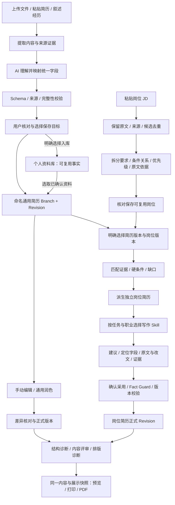

# 基础功能闭环审查与优化计划

- 日期：2026-10-23
- 状态：初版审查完成；实施待逐项启动，等待真实使用反馈持续补充。
- 执行索引与近期记录：根目录 `plan4.md` / `history4.md`；本文件维护详细设计和验收，避免重复长计划。新卷号与 V4 自治路线无关。
- 当前优先级：暂停继续扩展 V4，先完善基础功能。保留已实现的 V4 数据与能力，不回退、不删除。
- 本轮范围：源码与记录审查、少量基线验证、开源参考调研、制定计划；未修改产品代码，未开展实际页面视觉审计。
- 源码基线：`12fdb4b001111d60a93f91ed0a61d177ec93f9ec` 加当前工作区已有修改。

## 1. 产品目标与执行边界

用户上传或粘贴简历，系统可靠识别，核对后形成可编辑的命名通用简历；用户明确选择时同时写入资料库。用户粘贴岗位，系统保留原文、解析要求、核对保存并可复用。用户选择通用简历和岗位后得到独立岗位简历，通过对话优化、对照采用、检查和导出完成闭环。

AI 主导理解、组织、解释与提出修改；软件负责字段约束、版本、来源、确认、可靠保存和一致呈现。Hermes 继续是生产 Agent 执行器，专用结构化 AI 服务保留既有职责，不为此次改进另建运行时。

本计划不授权一次性实施全部阶段。每次选择一个有明确验收的任务，后续由用户实测问题调整顺序。不启动网站抓取、自治投递、cron、面试训练；不新增表或生产依赖，不做不可逆迁移。必要扩展先报告。

## 2. 本轮发现：已有基础与仍需验证的部分

“有实现”不等于“真实使用已验证”；以下风险不是全部已复现 Bug。

| 技术线 | 已有实现与证据 | 优先审查的问题 |
|---|---|---|
| 文件与文本导入 | `ResumeImportOrchestrator.ts` 支持 PDF、DOCX、JSON、Markdown、TXT；`ResumeDocumentSemanticMapper.ts` 对来源文档脱敏、分批调用结构化 AI 并校验 | AI 首页与手动导入是否等价；直接粘贴是否能到达同一核对流程；复杂排版和长文是否遗漏；扫描页是否真正进入可用识别链 |
| 路由与恢复 | `resumeImport/routing.ts` 已区分文本层、本地 OCR、人工核对、实验解析；导入器保留 AI 失败后的本地草稿并提供恢复信息 | 已有恢复是否在全部入口可见；是否迫使用户理解工程术语；是否存在只能重传、不能继续的断点 |
| 统一字段 | `resumeV2.ts`、`resumeJsonV2.ts`、`resumeFields/` 已有正式 Schema、字段目录和带来源的映射约束 | 对所有栏目逐项验证导入→编辑→改写→渲染，无丢字段、错类型、错 ID；不能仅因模型返回合法 JSON 就认定语义正确 |
| 导入确认 | Repository 统一保存；当前未提交 P2-C 改动补充显式建通用分支及分支结果说明 | 旧计划“JSON 未建分支”的债务不可直接视为现存未修复；当前改动的单测通过，UI/真实 Agent 确认链仍待核对 |
| 编辑与优化 | Branch/Revision、统一 target resolver、tailoring diff、事实门禁和独立岗位分支已有基础 | 连续对话、多份简历、跨栏目、并发编辑是否仍指向正确对象；拒绝、冲突与未应用是否清楚可见 |
| 经历组织与写作 | `resumeComposition/` 有 Blueprint、Writer、Reviewer、EvidenceGraph 和质量策略 | 是否产出具体、有价值且保留个人贡献边界的正文；技术词表偏技术方向，不能替代跨职业写作策略 |
| 岗位分析与保存 | JobDescription、RequirementGraph V3/V4、JobAnalysisDraft、jobWorkflow、candidatePipeline 已存在；db.ts 已声明五张 V4 表 | JD 拆分/优先级/逻辑关系是否准确；正式岗位与候选、草稿职责是否清楚；原文与分析结果能否回溯 |
| 评分与诊断 | `resumeDiagnostics/diagnosticEngine.ts` 有确定性 ATS 结构诊断；岗位匹配与 resume-review 已存在 | 不等同于成熟统一评分，也不等同于外部 ATS 认证；行业经验规则、分数解释和前后对比需专项验证 |
| 模板与输出 | registry 已注册六种渲染器，共享字段与展示能力；前置修复记录已完成 | 实际模板内容守恒、PDF 文本层、分页与预览一致性仍需固定样例验证；不宜先大量堆模板 |
| 首页与界面 | `ModeAwareHome.tsx` 分 AI/manual 首页；AgentQuickStartCards 提供六入口 | 六入口与手动页面是否完成同一任务；当前美观、密度、操作便利性尚未通过实际页面审查 |

文档状态差异：V4 计划头部仍写“待执行”，但前置计划记录 P-1A～P-1F 完成，history3 已记录 V4-P2-B 完成，源码已有五张表。以源码和对应测试为事实，不能因旧头部重新执行已有阶段。P2-C 是当前工作区已有未提交成果，不作为本轮交付。

本轮基线验证：`pnpm typecheck` 退出码 0；定向 Vitest 三文件共 26 项通过（resumeImportOrchestrator、resumeImportReliabilityHotfix、v4p2cJsonImportBranch）。未调用真实 provider，未上传个人文件，未运行应用/E2E/构建；不宣称真实链路或 UI 已通过。

## 3. 用户链路与技术导图

用户只需理解“正在处理哪份简历、哪个岗位、还有哪一步、结果保存在哪里”。导入成功应提供打开简历、查看资料、继续优化；任何步骤失败保留输入与进度，不把内部错误码当作全部解释。

### 六个首页入口的闭环验收

以 `AgentQuickStartCards.tsx` 的实际入口为准，不把用户描述的模块数等同于按钮数。

| 当前入口 | 起点与完成标志 | 关键异常 |
|---|---|---|
| 从零整理我的经历 | 叙述→少量有效追问→经历草稿→明确确认→资料可复用 | 不反复追问已有答案；会话中断可继续 |
| 导入现有简历 | 文件/粘贴→识别核对→按选择建资料/命名简历→打开编辑器 | 扫描件、无效输出、超时、重复导入、已有资料与已有简历 |
| 生成岗位定制简历 | 明确岗位和通用简历版本→匹配→独立分支→改写核对 | 无岗位/无简历要引导补齐后继续；不得修改来源分支 |
| 从资料库组装简历 | 选择人物、经历、目标→组织内容→确认→命名通用分支 | 不混用人物、不把学习目标写成已完成经历 |
| 分析岗位匹配度 | 粘贴/选岗位→核对解析→匹配现有证据→解释缺口并可复用 | 不把“没写”自动当作“不会”；不以关键词数量代替匹配 |
| 检查并导出简历 | 选定版本→问题列表→定位修复→预览→下载可打开 PDF | 未确认事实、过期诊断、溢出、文本丢失、导出失败 |

## 4. 统一数据底座：本计划的首要验收契约

统一的是字段语义、身份、写入协议与渲染来源；资料库事实、简历正文、展示配置仍分别承担职责。不能强行让三者持久化为一份完全相同 JSON，也不能各自自由发明字段。

| 层 | 约束 |
|---|---|
| 导入交换 | CareerAdaptResumeJsonV2 作为现有结构化交换契约，AI 输出经受控适配和 Schema/来源检查；外部 JSON Resume 等仅做边界适配 |
| 资料库 | 保存用户选择确认的可复用事实及来源；简历优化不隐式反写 |
| 简历 | Branch + 正式 Revision 保存该份简历内容与分支身份；通用与岗位分支隔离 |
| AI 改写 | 基于选定 branchId、revision、section/item 身份与规范字段生成 proposal/diff；应用前对比原文与版本，失效则重新核对 |
| 展示模板 | 只负责样式、布局和分页；切换模板不改变事实与正文，不重建另一套字段 |
| 输出 | 从已确认的同一版本派生 ResumeDocument/RenderModel，复用现有展示快照管道；ResumeDocument 不持久化 |

需要“改副本再替换”时，也应落实为既有分支/Revision 与原子应用协议，不能让 AI 覆盖一个无版本全文对象。命名、复制或切换模板均不得改变编辑目标。每个规范字段需要覆盖导入、编辑、AI 读写、预览、导出的支持矩阵；不支持必须明示，不能静默丢弃。

## 5. 各模块优化设计

### 5.1 导入：AI 优先理解，能力感知路由

1. 文本、Markdown、DOCX 和文本 PDF 优先提取有效文本、结构与来源，再让 AI 做语义字段映射；本地规则是提取/辅助候选能力。
2. 扫描 PDF、图片、混合 PDF 按页检查可读性，核对当前 OCR、视觉模型、provider 文件接口的实际能力。支持多模态的模型不代表当前适配器支持 PDF 附件；不得只根据模型名字宣称可用。
3. 视觉/OCR 路线与文本路线汇入现有来源文档与草稿契约，保留页码、原文片段、低置信度项和未分类内容。2026-10-23 已接入扫描/混合 PDF 转图及 PNG/JPEG 的当前模型识别，默认 AI 自动模式，复用规范字段和确认保存；本地 OCR 仍为可选路线。自动化测试不代表真实模型识别准确率，页面图像会向当前服务商传输未完整脱敏的信息，须明确说明。
4. 自动切换仅在已配置、用户允许且确有能力的路线内进行；涉及新增外部服务传输仍遵守现有隐私设置。缺能力时保留材料，提供具体配置/重试/继续核对动作。
5. 网络短暂错误采用有上限重试；认证失败引导设置，输出截断减少批量或拆分，JSON/Schema 问题做有约束修复，来源无法支持的字段进入核对。不能无限重试或凭空补全。
   导入等待时间已按阶段配置：设置 → 文档识别，每页图像默认 8 分钟、每批字段整理默认 10 分钟，分别可调 1～30 分钟；下一次请求/重试生效，格式修复重试共享本批预算，保留取消与超时恢复，不沿用其他 AI 任务的固定限时。
6. 保存目标明确区分：新建人物、并入已有资料、是否创建通用简历、简历名称；一次核对完成，不出现成功但找不到简历。重复点击幂等，中断后可恢复。

验收样例：中文单栏、双栏、表格、长简历、英文、扫描页、混合页、TXT/粘贴、DOCX、自定义栏目、空/损坏文件、超时/认证失败、输出截断、已有资料。分别记录字段正确性、遗漏、无依据新增、耗时与恢复完成率；先建立人工标注基线，禁止用“JSON 合法率”冒充识别准确率。

### 5.2 编辑与通用润色

手动编辑、对话改写和差异应用共用规范字段与 Repository 写入。用户可以指向某条经历、某一栏目或整份简历，但任务必须绑定选中简历版本；目标不明时只问一次必要问题。

经历组织先辨认工作、项目、教育、科研、校园等资产，再识别任务、个人动作、方法、规模和结果；保留“参与/协助/负责”的真实贡献边界。没有数据不编造指标，没有必要不强塞 STAR 句式，强内容可以保持原文。需要补充事实时就地提出具体问题，答案默认只属于当前任务，入库另行确认。

采用建议展示位置、before/after、理由、证据、风险和状态；支持逐条接受/拒绝以及既有版本恢复语义。连续修改、重命名、撤销与中断恢复不得串简历。

### 5.3 岗位解析与复用（重点）

先使用现有 RawInputDocument、候选、快照、JobAnalysisDraft 和正式 JobDescription 链路，不建第二套岗位库。对话粘贴与岗位页面共用解析和确认流程：原文可先保存为草稿，核对后再成为正式可复用岗位，不把外部原文自动当成已确认分析。

逐条审查：

- 岗位名称、公司、地点等与原文一致；缺失标记待核对，不能臆造。
- 要求区分职责、必须能力、加分项、经验、学历、证书、工具、语言及不明确内容；优先级不能由模型任意升格。
- 保留“或/且”、否定、范围、年限、等效条件与复合要求，拆分后仍可还原含义，避免一个要求拆成多条重复计分。
- 要求带稳定身份、原文定位、置信度和确认状态；分析结论与原文分开显示。
- 更新 JD 或人工修正后重新验证依赖的匹配/定制结果，旧结果明确标注过期；保存后立即可见，重复岗位允许解释后合并或保留。

界面审查方向：岗位列表帮助查找复用，详情优先呈现概览、关键门槛、核心职责/能力、原文依据、关联简历和下一步；复杂图结构留在需要时展开。具体布局必须先运行现有页面、截图和操作，再做局部设计，不能仅凭源码宣判重构。

### 5.4 定向优化与 Skill 分类

当前六个 portable skills 是：经历访谈、故事挖掘、岗位匹配、定向改写、通用评审、简历组装。它们已存在，新增行业方法应组合进这套任务流程。`ResumeSkillTaxonomy.ts` 的编程/工具词分类是候选人能力词表，不是职业写作 Skill 路由器。

用户后续提供的 skills 逐个建立方法卡：来源 URL、作者/许可证、版本、任务类型、职业族、资历、地区/语言、输入要求、输出契约、适用/不适用条件、证据要求、正反例、评测状态。职业族可从软件/数据、产品/运营、设计、市场销售、工程制造、科研学术、职能等开始，但未取得材料与验证前不宣称这些专家能力已具备。

路由次序：先确定任务（整理/通用润色/岗位匹配/定向改写/评审），再看明确目标岗位与资历、语言，最后组合一个主方法和必要通用规则。目标不明时用保守通用方法并解释需要的岗位信息；禁止因出现 Python 就默认全部采用程序员简历策略。记录此次使用的方法版本，冲突时事实与用户明确意图优先，外部 Skill 不能改变应用权限或直接写库。

Skill 输出应最终适配现有 proposal/diff 契约，包含定位、原改文、理由、证据与待确认事项。方法模板与视觉模板分离：某职业的表达策略不强迫切换版式。用同一组匿名简历做启用前后盲评，不以篇幅增长、术语数量或模型自评证明有效。

### 5.5 评分、反馈与修复闭环

分开呈现三种结论：

| 结论 | 判断依据 | 用户可采取的动作 |
|---|---|---|
| ATS 可读性/结构诊断 | 导出文本是否可提取、阅读顺序、栏目结构、联系方式、可测排版问题 | 定位结构问题、换兼容版式、修复后重新提取验证 |
| 岗位匹配 | 已保存 JD 要求、选定简历版本、事实证据、硬条件与缺口 | 展示要求与证据对照，补充真实经历或采用建议 |
| 内容质量评审 | 职业方法、贡献清晰度、具体性、相关性、冗余和证据充分性 | 给出具体条目理由、改写示例与保留原文的选项 |

没有岗位时不伪造岗位匹配分数。未知能力与不满足要求分开；缺口追问不能变成造事实。优先复用现有匹配和诊断引擎，不另造冲突评分真相。

若使用数值，实施前定义维度、权重、适用条件、未知项与扣分解释；事实风险独立显示，不能被高总分抵消。固定版本的确定性评分应稳定，AI 主观评审保留不确定性。报告绑定简历/JD/方法版本，修改后旧报告过期，比较同口径结果。不能宣称通用 ATS 通过率或录取概率，也不能把开源项目的营销分数当作实证。

### 5.6 模板与 UI

2026-10-24 用户已明确将模板调研纳入本轮实施。当前已新增“校园浅底”参考模板，并针对培训、排名百分比、技能呈现和编辑控件补齐统一 V2 链路；详细比对、源码借鉴、字段契约、限制与验收见 [本轮实施记录](resume-import-template-20261024.md)。此前“仅待调研、不在本轮实现”的约束已被本轮需求取代。

现有六个模板与默认 ID 保留，新模板只组合呈现统一数据，不为各个样式建立另一套业务 JSON。未来更多模板仍按实际需要逐项调研，不能据本轮授权自动建设所有主题。借鉴 JSON Resume 的纯渲染契约和 Reactive Resume 的结构/展示职责分离；具体文件、内容哈希和许可在实施记录中，未整仓引入或新增依赖。模板切换、长内容分页、预览和 PDF 必须核对内容守恒；不宣称未经验证的 HR/ATS 效果。

实际 UI 审查按导入、编辑、岗位详情、匹配、建议、导出分页面进行：记录任务步骤、误点、重复确认、找不到结果、错误恢复和必要截图；保持专业、紧凑、克制，优先主动作与当前状态。只改所选链路，不开展无关全站视觉改造。

## 6. 开源借鉴清单（2026-10-23 初查）

已查看以下官方仓库页面；这是候选参考，不是完成源码移植或方法有效性验证。

| 项目 | 借鉴目标 | 接入边界 |
|---|---|---|
| [Reactive Resume](https://github.com/reactive-resume/reactive-resume) | 简历编辑/模板配置/导入导出的一体化体验 | 挑选具体交互与实现阅读，保持本项目存储与分支模型 |
| [OpenResume](https://github.com/xitanggg/open-resume) | PDF 简历解析、解析结果检查与编辑体验 | 用本项目中文/复杂版式样例验证，不能假设规则能全格式通用 |
| [Resume Matcher](https://github.com/srbhr/Resume-Matcher) | 岗位定制、匹配反馈与 AI 工作流 | 审查其指标定义与提示词，再以本项目证据匹配评测，不照搬分数 |
| [JSON Resume Schema](https://github.com/jsonresume/resume-schema) | 外部标准交换字段与主题生态 | 原仓库已提示迁移至 jsonresume.org 的 packages/schema；仅边界适配，不替换内部 Resume Schema v2 |

每项借鉴落地前记录具体 commit/文件、许可证、所解决问题、适配差异和对比样例；不整仓引入、不默认换技术栈。招聘经验材料须另记作者背景、适用职业/市场、证据强弱与相反案例；开源热度不能证明招聘效果。等待用户提供的 skills 后补充来源卡与分类，不预先安装未经审查的技能。

## 7. 分阶段执行与交付标准

| 阶段 | 最小交付 | 可判定验收 |
|---|---|---|
| B0 实测与问题登记 | 运行应用走六入口，选匿名固定样例，形成失败与体验清单 | 每条问题有输入、步骤、预期/实际、证据；已复现和待验证分开 |
| B1 导入闭环，优先 | 先修用户最容易遇到的真实导入断点，再补能力路由/恢复 | 文件与粘贴到命名可编辑简历；选择入库准确；失败可继续；无静默丢内容 |
| B2 统一编辑与通用润色 | 字段矩阵、目标/版本定位、具体建议与采用 | 所有受影响栏目不串目标；手改/AI/预览字段一致，资料库不被隐式改写 |
| B3 岗位解析和复用 | 拆分逻辑、原文证据、核对保存、局部岗位 UI 改进 | 同一 JD 可复用，AND/OR 与门槛正确；更新后旧匹配失效 |
| B4 定向优化与职业方法 | 纳入首批用户提供的方法卡并做路由评测 | 不同职业采用恰当方法，独立岗位分支，建议有依据且可逐条应用 |
| B5 评审与评分 | 三类结论、解释与修复回流 | 每个问题定位到原文/要求；同版本可比较，不虚报外部 ATS 认证 |
| B6 模板、界面与比赛演示 | 现有模板稳定、所选页面优化、真实演示脚本 | 导入→通用→岗位→定向→检查→PDF 全程可演示，并有一次中断恢复 |

B0 首次实测应优先走导入闭环，不要求先完成全站报告。UI 改进与对应阶段一起执行，避免拖到最后才处理阻断操作的问题。若用户反馈暴露更直接阻断，可以调整上述顺序，但必须保留统一字段与事实边界。

每阶段记录 Git/已有改动、相关类型与源码、typecheck 和直接相关基线测试；修复按 Hotfix/Feature 最小充分门禁执行。涉及 UI 时运行应用与前后截图，相关 Playwright；涉及导入、模板、导出等生产边界时按项目规则运行 build。真实 provider 单独记录模型/能力、结果、耗时和失败类别，不记录密钥。没有可用凭据时标明未验证，mock 不替代实测。用户要求发布验收时再做 Release Gate；交付 Electron 安装包时才执行对应重新打包与安装验证。

## 8. 用户实测反馈入口

用户可以直接描述问题，不要求提供完整报告；开发者负责补齐以下记录：

| 编号 | 入口/步骤 | 输入类型 | 预期与实际 | 复现证据 | 根因状态 | 优先级 | 对应阶段 | 验收 |
|---|---|---|---|---|---|---|---|---|
| 待登记 | 用户接下来提供的使用问题 | 脱敏材料或最小样例 | 待补充 | 待复现 | 待调查 | 按阻断程度 | B0～B6 | 待验证 |

优先级：无法完成/丢数据/串人物或简历最高；结果错误与无法恢复其次；步骤繁琐与视觉问题结合真实影响处理。每完成一项，让用户能重新执行同一任务确认改善；不以新增按钮或测试总数作为基础功能完善的证明。
