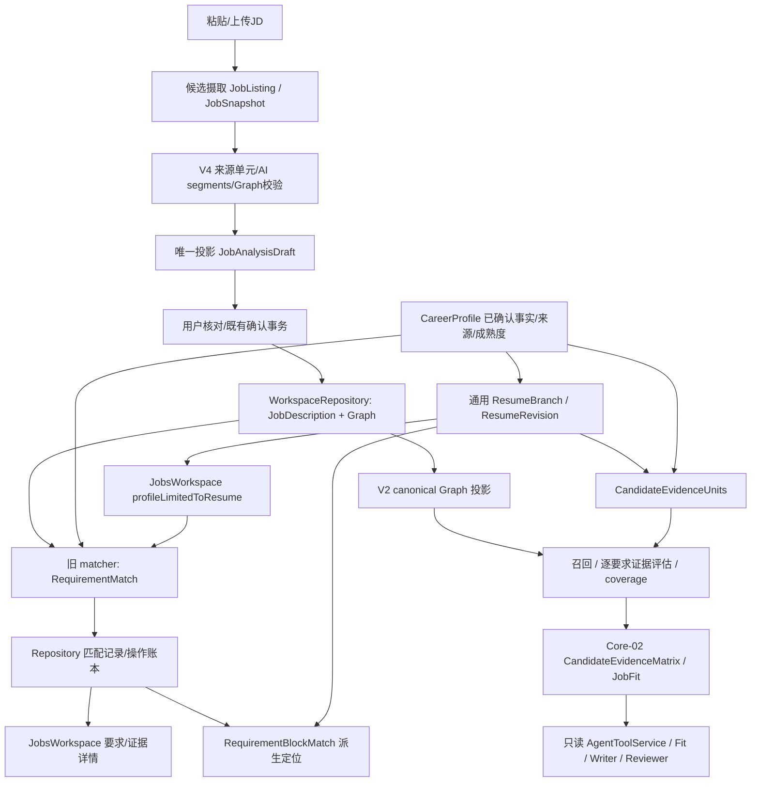
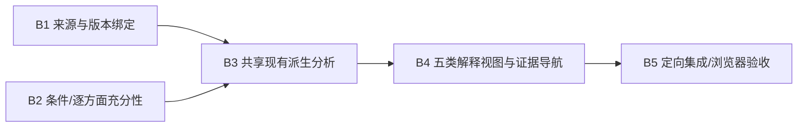

# P5.1-JD-02-A — Job Fit Intelligence Audit

日期：2026-11-04（Asia/Shanghai）。范围：JD-01 封存核验、现有实现审计、JD-02-B 建议；没有实施 JD-02-B。所有结论以 competition/5.1.8、`7facfde1853dda0c048f5cdcc31f16d5dd0a80f0` 为源码基线。

## 1. 结论与审计口径

已有岗位来源图、唯一正式 RequirementMatch、多对多证据引用、V2 证据单元/召回/评估、Core-02 CandidateEvidenceMatrix、只读 Job Fit、版本缓存、人工覆盖和区块定位。应沿现有链路补齐，不能再建一套匹配模型。

JD-02 整体为 **部分完成**：按第4节预先明确的18个能力项统计，4项已完成、12项部分完成、2项未实现。该统计是工程能力盘点，不是模型准确率，也不能换算为“已完成百分之多少”。五类差距中，明确/部分支持已有基础，可能具备与信息不足合并为 unknown，已确认暂不具备尚无独立可靠输出。

最高优先级：①当前简历的事实级来源隔离；②读取与异步回包时的版本/选择绑定；③JD-01 布尔条件贯通已有证据链并区分相关性和充分性。先修这三项，再让页面统一消费既有 Core-02 派生分析。

“静态确认”表示可从调用和赋值证明；本轮没有为所有新发现逐项新增复现测试，也没有运行浏览器，因此 UI 新风险不冒称已经浏览器复现。既有合成测试通过不等于真实 Provider 质量认证。

## 2. JD-01 封存核验

### 2.1 Git 与范围

- branch：`competition/5.1.8`；HEAD：`7facfde1853dda0c048f5cdcc31f16d5dd0a80f0`，标题 `JD-01`；父提交 `82d465c042b39db903b49b3ad171b28a28f5e3ed`。
- 起始 `git status --porcelain=v1 --untracked-files=all` 为空。JD-01 已在本轮之前提交；旧 plan/history/handoff/report/evidence 中“尚未提交、未推送”是交付时历史状态，不能当作当前 Git 状态。
- origin：`https://github.com/ETO-MQC/CareerAdapt-AI.git`；另有 target remote，未使用。`git ls-remote origin refs/heads/competition/5.1.8` 返回同一 HEAD，本地 origin 跟踪也同 HEAD。仅查询远程，没有 fetch、提交、推送或导入其他分支。
- JD-01 提交共43文件：12生产文件、4测试/夹具文件、报告/handoff/机器证据及24个日志/JSON/截图。12份生产源码规范化 LF SHA256 全部匹配机器证据。未发现工作区残留或报告之外的生产修改。
- `plan4.md`、`history4.md` 被既有忽略规则排除；本轮继续维护，不强制纳入 Git。

### 2.2 验证证据逐项对账

| 项目 | 原证据核验 | 本轮动作与结论 |
| --- | --- | --- |
| 174 Unit/Integration | `unit-integration-qualified.json`：total/pass=174，fail/pending=0，success=true；日志15文件174/174 | 使用日志中的同15文件重新运行，174/174，完整exit 0 |
| Playwright | `playwright-final.log`：JD-01合成AI来源拆分保存刷新、原AI训练师场景，2/2；原失败日志另存 | 只核验证据与测试源码，未重跑；不能证明本报告新增的切换/并发风险已关闭 |
| typecheck | `typecheck-delivery.log`，机器证据exit 0 | `pnpm typecheck`重新运行exit 0 |
| ESLint | `eslint-qualified.log`为空，机器证据exit 0；`eslint-final.log`实际保留一次失败，不能按名称当最终通过 | 原16个TS/TSX显式路径，`pnpm exec eslint ... --max-warnings=0`重新运行exit 0 |
| Build | `production-build.log`有编译/类型/页面生成完成与路由表，机器证据exit 0 | 只核验历史证据；未build/打包；原目录Junction直接build资格仍未成立 |
| 构建源一致性 | 原证据478份src LF一致、lock一致，构建在B.2内部依赖worktree | 本轮核实12份交付源码哈希0差异；未重新认证整个外部worktree或478份文件 |
| diff | 原机器证据称工作区`git diff --check` exit 0 | 当前干净工作区检查与“提交内容检查”不同；`git diff --check HEAD^ HEAD` **exit 2**，605行诊断输出，主要为日志CRLF被认作尾随空白及fixture末尾空行。605不是问题文件数 |

原始证据入口：[JD-01报告](p5.1-jd-01-job-intelligence-enhancement-20261104.md)、[机器证据](../quality/jd-01-implementation-evidence-20261104.json)、[174逐项JSON](../quality/jd-01-logs/unit-integration-qualified.json)、[Playwright日志](../quality/jd-01-logs/playwright-final.log)、[Build日志](../quality/jd-01-logs/production-build.log)。原过程失败和最终成功均保留，本轮不改写历史日志。

**正式提交判断**：JD-01 工程功能证据充分，且事实上已经提交并存在于 origin，无需重复提交。若“正式封存”要求提交内容diff门禁和当前交接状态完全一致，尚需一个独立的文档/格式收口；不能宣称所有封存项全绿。真实自然语言质量仍 `UNVERIFIED_REAL_MODEL_REQUIRED`，不构成工程测试失败。

### 2.3 建议提交清单（本轮不执行）

1. JD-01 原提交保持 `7facfde`，不要重新暂存43文件或重写提交。
2. 本轮独立审计提交候选：本报告、`p5.1-sq1-current-handoff.md`；plan4/history4仅本地交接。
3. 若用户选择消除旧提交格式告警，另做只规范换行/EOF的提交，范围由`git diff --check 82d465c 7facfde`列出的明确文件逐项确认；不删除日志、不混入算法修复。本轮未实施。
4. JD-02-B 独立授权后另行开发、验证和提交，不与审计混合。

## 3. 当前架构与完整数据流

两条消费链已经存在，不是两个都应新建的产品：RequirementMatch 为正式匹配记录；V2 matrix/Core-02 为既有只读派生结构。当前 JobsWorkspace 没有统一展示 Core-02，这正是最小整合点。

### 3.1 岗位要求与来源

- `src/domain/schemas/job.ts:88`起 JobRequirement/JobDescription：要求、priority、hardConstraint、sourceSpan、keywords、keywordLogic，Graph允许V3/V4。
- `src/domain/schemas/jobOptimizationV3.ts`、`jobOptimizationV4.ts`：requirements/groups/sourceCoverage/semanticUnits等；JD-01的semanticAliases保留在Graph，keywordLogic贯穿正式要求。`src/domain/jobOptimization/v3/project.ts:24`投影 keywords 仅取exactKeywords，未把aliases写成精确词。
- `src/domain/schemas/jobDiscovery.ts:250` JobSnapshot：listingId/version/contentHash/rawText/provenance/redaction/capturedAt；它是来源快照，不是个人能力匹配结果。`JobsWorkspace.tsx:190`起摄取/草稿链，保存仍经原Repository。
- `src/domain/schemas/job.ts:188` RequirementMatch：一条requirementId，多条evidenceRefs，同一fact可用于多要求；`tests/integration/jd01Persistence.test.ts:45`覆盖多对多。每条ref没有独立评分、方面覆盖或来源定位字段；不能把记录级评价说成逐证据评价。

### 3.2 个人经历、证据、确认与隔离

- `src/domain/schemas/profile.ts:64`起 Experience/Evidence/Skill/Certificate与`:123` CareerProfile：正式facts与文件/链接证据、structuredFacts/sourceBlockIds/sourceRanges/provenance；不同profile是独立选择上下文。
- `src/domain/schemas/common.ts:142` FactStatement：statement/provenance/confirmedByUser/riskLevel/maturity。`src/domain/profile/factMaturity.ts`区分demonstrated、confirmed_capability、familiar、learning，并有历史兼容投影。成熟度不是“是否具备”的完整否定状态。
- `src/domain/schemas/branch.ts:208` ResumeRevision保存branch snapshot/previousRevision；ResumeBranch绑定profile、来源、revision、currentRevisionId、contentItems/structuredContentItems。匹配引用应绑定当前选择的正式版本，不能只绑定经历容器。
- `src/domain/schemas/resumeImport.ts:160` ResumeSourceDocumentV2有sourceId/kind/hash/blocks/quality；`src/domain/profileIntake/ProfileIntakeSourceTurn.ts:56`记录session/message/turn/exactSourceText/hash/branch/stage/处理状态；这些是来源证据，不自动成为确认事实。
- Claim不是可随意扩充的能力库：`src/domain/schemas/tailoring.ts:179` ConfirmableClaim有sourceItemIds/requirementIds/patches；`:408`起TailoringClaim另有安全与成熟度约束。`src/domain/jobOptimization/claimGuard.ts`和既有确认写入链保持不变。
- `matcher.ts:83`只收有用户确认fact与至少一个确认provenance；不直接OCR原文/SourceTurn/未经确认草稿入证据；但旧matcher未读取maturity，且确认来源选择与展示引用可能不一致，见问题矩阵。
- V2 `evidence.ts:19`按可见结构化条目、factRefs/用户明确声明构造单元，summary排除，声明保留user_declared/confirmed_capability。用户确认能力不等于已证明项目经历。Core-02测试覆盖无资料不生成Kubernetes能力、无反写、来源/成熟度受限检索。

## 4. 已有能力与问题矩阵

“完成”仅指表中窄契约已有实现和对应测试，不代表整个岗位智能完成。

| ID / 能力 | 状态 | 实际依据、局限与影响 |
| --- | --- | --- |
| A1 JD来源图/确认保存 | 已完成 | JD-01 Graph、Repository重开/幂等、原文引用；`jd01Persistence.test.ts:19`及JD-01 E2E |
| A2 多对多正式匹配 | 已完成 | job.ts:188、matcher.ts:47/345、Repository:4062/4099，集成测试:45；不含逐ref评分 |
| A3 原始资料与正式证据隔离 | 部分完成 | 确认fact过滤存在；JobsWorkspace:680按experienceId保留整项，未限定factId/可见条目；已选F1会带入同经历F2（静态可推导），不能保证当前简历隔离 |
| A4 版本化来源模型 | 已完成 | branch.ts:208、jobDiscovery.ts:250、RequirementMatch来源revision字段；matcher测试覆盖来源revision变化；页面消费完整性另列A13 |
| A5 成熟度一致性 | 部分完成 | factMaturity/evidence.ts已有门禁，旧matcher仅确认判断；同一learning/familiar事实可能在两入口得不同支持等级 |
| A6 精确词与词边界 | 部分完成 | matcher.ts:151/193、containsKeywordTerm、JD-01 Java≠JavaScript测试；不解析否定、年限/证书有效期等充分性 |
| A7 同义/语义召回 | 部分完成 | V2 evidence.ts:64使用aliases、词项/BM25-lite/ngram；旧matcher不读Graph aliases，只有10个迁移词；AI也只看到旧召回前5项，漏召回不能靠rerank补救 |
| A8 any_of/all_of组合 | 部分完成 | JD-01保存/展示keywordLogic和groups；旧matcher只在strong时给all_of缺项降级，any_of未独立求满足；V2 analyze.ts:80投影未带keywordLogic/groups，evidence direct对exactKeywords全部every；coverage按单节点加权，未做group最低满足数 |
| A9 must/preferred分类 | 部分完成 | Graph和V2 coverage有权重/硬约束扣分；不能在丢失any_of后把未选替代项都当缺口 |
| A10 证据相关性/充分性 | 部分完成 | 旧规则按最佳候选命中≥2 strong，所有召回ref附同评价；V2有类型/成熟度/coveredAspects，但命中词/相似度不能完整证明年限、独立责任或每个条件 |
| A11 unknown保护/五类差距 | 部分完成 | careerIntelligence.ts:33只产生direct/transferable/partial/unknown；tailoringService.ts:88明确缺证据不等于不具备；possible与insufficient未分开，none不能直接映射实际能力不足 |
| A12 已确认暂不具备 | 未实现 | CandidateEvidenceMatrix Schema虽允许mismatch/conflicting，buildCareerIntelligence没有产生分支；maturityForTailoringAnswer对否定返回undefined；没有已核实的requirement级负向能力结论输出，不能按Schema枚举宣称完成 |
| A13 stale恢复/重新计算 | 部分完成 | matcher.ts:278/313和Core-02 cache有版本检查；JobsWorkspace:176只list+按branchId取最新，未调用stale检查；Repository:4208只parse，页面:670只读持久isStale；旧结果可在来源revision变化后被当新鲜 |
| A14 原因与原文展示 | 部分完成 | JobsWorkspace:661显示explanation/factText/factQuote；无逐ref方面充分性，不校验显示quote属于当前事实文本（matcher validateEvidenceRef只核ID/确认） |
| A15 要求到经历导航 | 部分完成 | matching.ts:52已有区块factRefs交集定位，ResumeWorkspace消费；JD RequirementArticle只显示ID/文本，无跳转到item/field/原文页链接 |
| A16 切换/刷新一致性 | 部分完成 | JD-01 jobId URL刷新通过；sourceMode默认profile、resumeId初始空，刷新不恢复该选择；选择事件清显示、加载effect有active取消，但长AI回包runOptionalSemanticEvaluation:466无选择令牌，切换后仍setMatches（静态风险，未E2E复现） |
| A17 五类差距专用交互 | 未实现 | JobsWorkspace:640只有“已有事实支持/暂无事实支持”，:670显示原始matchLevel；无五类解释、澄清/用户否认回显入口 |
| A18 只读共享分析与失效缓存 | 已完成 | careerIntelligence.ts:10/69、tailoringService.ts:88、BrowserAgentToolService:1806；Core-02测试确认Fit/Writer/Reviewer同analysisId、版本失效、无Profile/Branch写入 |

合计18项：4已完成、12部分完成、2未实现。A3/A8/A13/A16等是本轮静态发现，现有174测试通过不表示这些反例已经覆盖。

## 5. 算法与用户语义的具体断点

1. **双入口分歧**：资料库分析`jobResumeSourceModes.ts:30`使用V2 matrix/coverage选材；创建时`JobsWorkspace.tsx:394`另跑旧matcher保存记录。通用简历入口`:411`使用旧matcher并可选旧AI。用户可能先看到一种推荐，要求详情却展示另一种评价。最小修复应复用Core-02/V2派生解释，以requirementId对齐既有正式记录，不建第二个RequirementMatch。
2. **组合误判**：单词Python满足“Python或SQL”应可满足该分支，不能因为只中1词就最多weak；“Java和Spring Boot”必须验证每项，不能只用最佳一条证据2 token给strong。组内一个选项成立，不等于其他选项都是能力缺口。现有实现的局限由A8调用与every条件可直接确认。
3. **证据稀缺被呈现为缺口**：旧matcher无召回→none/source_missing；硬约束再加hard_constraint_gap，解释中写“硬性条件缺口”；V2 coverage将none等计blockingGaps并扣分。分数是证据覆盖，不是能力判决；只读Fit文案已保护unknown，但JD页面没有统一继承该解释。
4. **“有引用”不等于“足够支持”**：UI摘要按evidenceRefs.length显示支持，即使评价none/weak也可能有引用。旧评分best-only但所有候选共享评价；“暂未独立完成Python SQL”仍包含2词，旧规则没有完整否定判断。此为规则静态反例，不宣称真实模型曾产生错误。
5. **引用质量**：matcher的primarySourceText总取provenance[0]，确认检查却是some；第一来源未确认、后续来源确认时显示哪条依据需明确。validateEvidenceRef没有核对AI返回factQuote/factText等于正式来源，也没有限制为本次recall集合；V2评估则已有out-of-recall拒绝。这里审计的是匹配解释完整性，不等于事实写入安全已被绕过，不能扩大修改Guard/Repository确认边界。
6. **过期与异步**：旧匹配可检stale不等于页面已执行；Core-02缓存binding完整不等于JobsWorkspace已使用它。异步持久化结果可以继续保留审计，但返回旧选择的结果不得覆盖当前页面。页面需要按profile/job/branch/revision/graph绑定呈现。
7. **旁支工具不能冒充接入**：`jobAssets/matchDerivation.ts`有overall-fit/coverage/hard-gate纯函数和`v4p1MatchDerivation.test.ts`，源码检索未发现生产消费者；输入等级还与当前RequirementMatch（transferable）不同。`evidenceDiagnostics.ts`是原文定位包装，不能据此宣称JD详情已有原文件导航。保留，不重建、不自动启用V4。

## 6. 五类差距的复用方案与边界

| 用户需要的状态 | 现有基础 | JD-02-B建议的派生语义 |
| --- | --- | --- |
| 有明确证据支持 | direct/demonstrated、confirmed facts | 每个必要方面均有可定位证据；标明当前来源与版本 |
| 有部分证据支持 | partial/transferable、coveredAspects | 指出支持方面与尚未证明方面，不把迁移经历说成直接经历 |
| 可能具备，但缺证据 | confirmed_capability/user_declared、unknown | 只在已有用户声明或有限积极信号时标“待补证”；不能凭JD推断 |
| 已确认暂不具备 | 现有澄清回答/来源证据，尚未形成可靠分类 | 只能根据既有显式用户否定并绑定要求/时间/来源派生；不能把none、学习中、skip、不确定当否定 |
| 信息不足，需要澄清 | unknown/needs_confirmation、factGaps | 无可靠积极/消极判断时保持未知，提出具体澄清问题 |

不扩展Resume Schema v2，不新增持久化能力状态表，不把五类状态塞成另一个正式匹配模型。优先在现有CandidateEvidenceMatrix/JobFit派生出口提供解释视图（保持旧字段兼容），正式RequirementMatch仍唯一；若现有确认记录不能可靠定位用户否定，就保持“信息不足”，不伪造第四类已闭环。

不得为了五类齐全而新增确认协议。若实施核对发现现有回答存储不能承载可回放的否定证据，应将该闭环明确列为待授权事项；用户审阅前不实施数据语义变更。当前审计不修改六个Skills，也没有充分证据证明问题来自Skill文本。

## 7. 与 JD-01 的衔接与最小增量依赖

固定复用JD-01的rawText/sourceSpan、稳定requirementId、Graph semanticAliases、keywordLogic/groups、人工核对结果与matcherVersion失效机制。历史Graph缺少可选字段时保留旧读取能力，显式重算，不静默重写JD或用户材料。

- B1先修事实级过滤、可见性和异步结果归属，复用既有版本检查；不修改持久化安全协议。
- B2在现有Graph到V2的适配与现有证据评估器保留布尔语义，别名只用于召回/分类解释；复用classifyKeywordRelation，不能把相邻技能当同义词。
- B3将既有Core-02分析ID/证据矩阵与唯一RequirementMatch按ID连接；资料库、简历、Agent只读Fit沿同一版本绑定和解释政策。保留已有记录/API兼容，不迁移表、不另建主模型。
- B4复用区块定位、SourceDocument/SourceTurn出处，展示支持方面、未知原因、原始证据和当前来源。独立“分析/重新分析”应可阅读结果，不因查看差距就自动创建岗位分支；创建仍走原显式操作。
- B5先定向验证，只有真实改到布局/交互结构时按项目规范做必要前后截图；不升级全站Release Gate。

## 8. JD-02-B 实施计划与验收标准（建议，未执行）

| 子任务 | 最小改动点 | 必须通过的验收 |
| --- | --- | --- |
| B1 来源/新鲜度 | JobsWorkspace来源投影与恢复effect、复用matcher stale helpers、异步选择绑定 | 同经历F1选中/F2未选，F2不得参与；隐藏条目不参与；另一简历/另一profile不能渗入；branch revision、job version、matcherVersion或graph内容变更即失效；旧AI晚返回不能替换新选择显示 |
| B2 布尔/充分性 | v2/analyze适配、v2/evidence既有召回/评估、coverage组派生、旧matcher兼容解释 | Python或SQL仅一项有证据可满足任选分支；Java和Spring Boot缺一只能部分；两证据可联合支持all_of；group minimumSatisfied正确；preferred不当硬缺口；JavaScript不能证明Java；相关/同义与相邻严格区分；年限/否定/责任不足保持待核对 |
| B3 共享解释 | careerIntelligence + tailoringService + JobsWorkspace消费；沿唯一RequirementMatch复用 | 同一版本输入资料库/简历/只读Fit的requirement ID、证据与原因一致且可追溯；source/analysisId可核；不新增表或第二个匹配主模型；不改事实写入/确认机制 |
| B4 五类与导航 | 现有派生出口兼容解释视图、JobRequirements/已有Resume定位 | 五类各有匿名离线反例；缺资料不得显示不具备；skip/不确定不能算否定；第四类必须有显式否定证据，否则标未闭环；要求可定位到实际条目/字段或明确说明无法定位，不造页码；查看结果不自动创建分支 |
| B5 回归 | 相关Unit/Repository Integration/1—3条定向Playwright | 原174不降断言；来源切换+岗位切换+刷新+过期重算+迟到回包；无Key/真实Provider；typecheck、changed ESLint、相关测试、build、diff完整exit0；必要截图；plan/history与报告一致 |

实施顺序B1/B2→B3→B4→B5。不能以整库重构替代最小修复；如需扩大数据语义或持久化负向声明，停止并交用户选择。不进入JD-03、不导入main/5.2.1、不改Hermes/Planner/AgentRuntime/Resume v2/FactGuard/ClaimSafety/Confirmation/CAS，不新增依赖。

## 9. 本轮验证、限制与交接

- 本轮重新执行：原15测试文件174/174 exit0；pnpm typecheck exit0；JD-01原16个TS/TSX ESLint --max-warnings=0 exit0；12生产文件LF SHA逐项匹配；原174JSON、Playwright/Build日志核验；远程只读ls-remote与HEAD一致。
- 原174命令：`pnpm exec vitest run tests/unit/matcher.test.ts tests/unit/p40g-graph-v3.test.ts tests/unit/p40g-integration-pipeline.test.ts tests/unit/jobOptimizationV2.test.ts tests/unit/jobSemanticCompilerV4.test.ts tests/unit/p40g2-golden-jd.test.ts tests/unit/jdAnalyzerContract.test.ts tests/unit/jd01RequirementGraph.test.ts tests/unit/skillsQualitySq13B.test.ts tests/unit/jobWorkflow.test.ts tests/unit/repositoryTailoringV2.test.ts tests/unit/jobOptimization.test.ts tests/unit/storage.test.ts tests/integration/jd01Persistence.test.ts tests/unit/p51-core-02-intelligence.test.ts --reporter=dot`。
- 本轮审计仅文档写入；不新增运行时代码或测试，不调用真实Provider、不读Key/个人数据库、不修改历史日志。未重跑Build/Playwright/全量门禁，未打包/提交/推送。
- 历史提交diff检查exit2已如实记录；本轮文档diff单独检查，不把工作区干净或本轮文档通过说成JD-01提交diff已通过。
- plan4/history4与当前handoff记录实际HEAD、已提交事实、本轮审计状态和待审阅项。下一步仅用户审阅选择JD-02-B范围，本轮停止。
