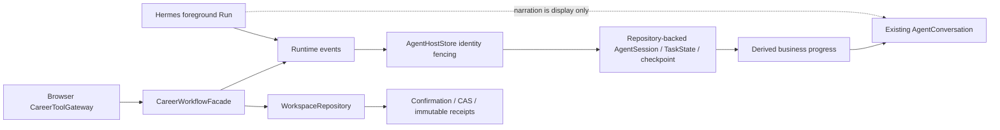

# P5.1-UX-01.2 — Business Workflow State, Progress & Recovery

日期：2026-11-05 开始，2026-11-06 收口。阶段 **PARTIAL**。核心状态接线和分层验证完成；新增浏览器验收首次配置引导前置条件未满足，首次断言超时后停止，不能宣称完整 UI/恢复闭环通过。尚未提交、推送或打包，不自动进入 UX-01.3。

## 基线、范围与历史审计

起点 `competition/5.1.8` / `37c5542e0a86607455e8e2f38e2b39a27c3dbc0b`，工作区干净。根目录 plan4/history4 的 UX-01.1-R「尚未提交」是历史状态；该阶段已包含在当前 HEAD。读取当前 AGENTS、交接、UX-01.1/R 报告、RP-01.1 与相关源码/测试，不重审已关闭 JD-03-R、RESUME-01 或奖项契约。未使用子 Agent。

原始 `ux-01.1-r-logs/ux-a-trace.zip` 离线读取，317 条 test.trace 事件中保留原 `knownSlots` TypeError；摘要见本轮 `ux-a-trace-audit.json`。结合原浏览器日志和 Host 源码判定：**测试过早读取和真实持久化时序缺口同时存在**。一般工具终态只更新内存；Facade 已产生候选投影，UI 可以显示候选，但尚未把该 TaskState 保存到 Repository。原测试等待 Run 中的即时落库是假设错误；即使修正等待，刷新窗口仍实际存在。

在原 Host 集成增加「工具回执后、Run 终态前，持久化投影与 UI 投影一致」断言，修改前稳定失败（checkpoint-repro.log：1 失败/1 通过），修后通过。不是凭历史失败推测产品缺陷。UX-A 浏览器仍独立 PARTIAL；本轮运行次数 **0**，UX-B **0**，奖项未重开。

## 开源源码研究

仅吸收执行身份、回执驱动、暂停恢复和分离完成语义；没有复制源码、引入依赖、工作流引擎或 UI 设计。固定 commit 下 LICENSE 和文件已通过 GitHub connector 实际读取，12 个来源记录见 `../quality/ux-01.2-logs/upstream-sources.json`。

| 项目 | 固定 commit / License | 实际相关源码 |
|---|---|---|
| [Dify](https://github.com/langgenius/dify/tree/e994c3ffe9482797df8546a921142868db4dc6ac) | `e994c3ffe9482797df8546a921142868db4dc6ac`；修改版 Apache-2.0，含多租户及前端品牌附加条件 | `api/core/app/apps/common/graph_runtime_state_support.py`、`api/services/workflow_pause_service.py`、`api/services/workflow_event_snapshot_service.py` |
| [LibreChat](https://github.com/LibreChat-AI/LibreChat/tree/f4154b649efa37e1345ccc517a4d8d1ed2178c82) | `f4154b649efa37e1345ccc517a4d8d1ed2178c82`；MIT。旧 danny-avila 地址已重定向 | `client/src/hooks/SSE/abort.ts`、`final.ts`、`resumable.ts`、`useContentHandler.ts` |
| [Open WebUI](https://github.com/open-webui/open-webui/tree/c38885a1a737da4968f157092f304f3b5481d0bf) | `c38885a1a737da4968f157092f304f3b5481d0bf`；Open WebUI License，含品牌条款，不记成纯 BSD/MIT | `backend/open_webui/tasks.py`、`src/lib/components/chat/Chat.svelte` |

| 研究点 | 上游实现 | CareerAdapt 当前实现 | 本轮吸收 |
|---|---|---|---|
| Run 生命周期 | Dify RuntimeState 校验执行 ID；Open WebUI task ID/生命周期独立于消息 | HermesRunHandle + activeTurn + TurnController | 保持原枚举；校验 session/turn/run 身份，不让错误句柄覆盖前台 |
| 工具执行 | LibreChat 内容处理与 final/abort 分开；Open WebUI statusHistory 与消息 done 分开 | Host activity、Gateway result、Facade checkpoint 已存在 | 工具终态先落库，再发布；失败回执约束终态叙述 |
| 用户等待 | Dify 从持久化 pause state 推导待审批表单；缺失表单失败而非猜测完成 | TaskState、WorkflowUserInputCheckpoint、pendingConfirmation | 派生等待输入/审核/确认，不新增持久化状态机 |
| 失败恢复 | LibreChat earlyAbort 恢复 draft/context，resumable 绑定 stream/status；Open WebUI 从实际 task 集合恢复 | 原安全 checkpoint、确认回执、Repository 幂等恢复 | 复用原确认与重试，补 Repository 故障/429 回归，不自动重放写入 |
| 任务进度 | Open WebUI chat_id/message_id 过滤事件；实际 status 事件独立呈现 | 工具 activity 已有真实 operationId，但业务含义不集中 | 紧凑业务进度行；Run 完成后有待处理工具时继续显示核对回执 |

研究访问限制：直接 Python HTTPS 握手失败，Web 对 API 地址不可用；GitHub connector 的固定文件读取成功。LibreChat/Open WebUI 全树列举超时，改用有界目录和源码读取；未进行全仓审计。上述是设计比较，不构成上游完整异常行为认证。

## 状态来源与权威图

| 状态来源 | 产生/更新者 | 消费者及本轮边界 |
|---|---|---|
| Hermes Run | 唯一生产 Hermes Runtime/transport；queued/running/waiting_for_approval/stopping/completed/failed/cancelled | Host 校验句柄；UI 不将 completed 等同业务完成。timeout/interrupted 继续使用原错误诊断/aborted，未扩充协议枚举 |
| Host activeTurn / Tool Execution | beginRuntimeShell、事件串行队列、Gateway 结构化结果 | current turn activity、toolFailures；自然语言不写完成证明 |
| Facade | 实际业务调用返回 status/workflowStage/checkpoint/receipts | 原 TaskState 投影；在既有 activeTurn.workflowCheckpoint 下补紧凑 facadeObservation，覆盖无 TaskState 的只读审阅 |
| Agent Task / checkpoint | 原 Reducer、Host 确定性转移、Facade | GoalCompletionGuard 和派生业务展示；不新增 Planner 或数据库表 |
| Confirmation Receipt / Repository | 用户明确确认后的原事务、CAS、幂等 operationId | 正式提交结果仍由原事务和回读验证；会话投影不替代不可变回执 |
| ExportRecord/导出产物 | 原 export 工具及 Repository | 仅表明对应派生产物；失败保留正式简历，单独提示重导出；本轮未改导出实现 |

权威原则：正式保存沿用 Repository/确认回执及已有回读逻辑，GoalCompletionGuard 继续约束整个目标；Facade 回执只证明对应步骤，job_fit 成功不能完成尚未确认写入的岗位简历。Run 终态约束执行状态。模型文字仅展示。已有完成业务结果遇到之后的 Run 失败/取消显示 partial，不声称结果被回滚或丢失。

## 最小实现及转移

| 文件 | 修改理由 |
|---|---|
| `src/agent/runtime/AgentHostStore.ts` | 工具终态落库先于 UI；同一当前轮已启动待处理工具允许在 completed Run 后补回执，失败纠正旧成功叙述，禁止恢复 Run 为 running；未知操作、旧 turn、错误 run/session、failed/cancelled Run 仍隔离；无 TaskState 的工具失败也阻止模型伪成功；在既有 turn checkpoint 记录 Facade 观察 |
| `src/agent/runtime/businessWorkflowProgress.ts` | 纯派生状态/业务文案/恢复提示，不执行操作、不持久化第二套状态；复用 GoalCompletionGuard |
| `src/components/agent/AgentBusinessProgress.tsx` | 一条低噪声、可访问的业务状态及必要下一步，无百分比/统计/大警告卡 |
| `AgentConversation.tsx` / `AgentWorkspace.tsx` | 在现有对话接线派生进度，不改变布局或确认入口 |
| 本轮测试及 `ux011Host`、`resumeCompositionConfirmedWriteP45c12`、`p45c17-hermes-reliability` | 复现持久化窗口、真实 Facade/Host/Repository 接线、错误完成、Run 身份、Repository 故障恢复、429 单请求、幂等/CAS 和组件呈现 |

展示使用 idle/submitted/processing/awaiting_input/awaiting_review/awaiting_confirmation/committing/completed/partial/blocked/failed/cancelled；均为现有数据的视图，不作为写入授权。只显示一个实际当前阶段，具体工具阶段取自当前轮真实 pending activity，后台/旧轮 activity 不算业务进度。

典型转移：接收→处理→审核/补充→明确确认→保存中→业务回执+目标 guard→完成。模型 Run completed 但 pending 工具未回执→核对操作结果。工具失败→失败或部分完成；迟到模型文字不能恢复成功。stop 请求处理中→核对取消结果，只有权威 cancelled 显示已取消；本地 aborted 而无可核验远端句柄显示中断/待核对。

## 四条业务流程与恢复证据

| 流程 | 本轮实际验证 | 尚未证明 |
|---|---|---|
| A 资料整理 | 真 Facade/Gateway/Host/IndexedDB：候选源绑定、Run 活跃时持久化、编辑/舍弃、明确 Repository 确认及重复确认不重复写；原 Profile 未隐式更新 | UX-A 编辑→确认→刷新完整浏览器；没有把分层结果拼为 UI 通过 |
| B 岗位解析 | 真 Facade/Host/Repository analyze_only 快照与条件图、切换隔离、刷新持久化、正式岗位库不变；展示区分临时解析与正式保存 | 本轮未重跑 UX-B；人工逐项核对及正式保存完整浏览器未新增认证 |
| C 岗位/通用简历确认写入 | 原事务契约测试覆盖确认、CAS、重复/并发恢复；新增 Repository 正式写方法故障→保留提案→同确认恢复→一个分支一个 Revision；导出失败单独 partial | 没有真实 Hermes+真实模型→岗位版本→实际 PDF 全链；未冒称本轮 PDF 输出通过 |
| D 通用只读审阅 | 真 executeCareerWorkflowFacade→Host→Repository：仅调用 plan_composition 且 reviewOnly=true 一次；无 Writer 调用/正式分支；无 TaskState 时真实 Facade receipt 可恢复并正确完成 | 原子审阅返回为受控桩，不是实际模型审阅质量认证 |

异常处理继续复用既有恢复动作。缺目标等用当前 user-input checkpoint；JD/原始用户消息保留。429 不自动第二次 Run/不切换模型；超时明确核对运行与保存回执。CAS 要重新读取审核；Fact Guard 要核对来源；写入失败保留提案，不伪造完成。未知是否已提交的事务仍先走现有回执恢复，不新增「一键自动重写」。

前后台边界：RP-01.1 已证实 background_review 是每轮 fork，周期维护另有来源。本轮未改 Hermes 工具/配置/后台能力。Run/turn/session fencing 拦截携带其他身份的事件；当前 Runtime 未独立暴露每个 background fork 的成本/回执，不能统计为用户进度、前台成功或零成本。

## 验证与失败保留

完整命令/日志路径与退出码见 `../quality/ux-01.2-implementation-evidence.json`。

- 基线 typecheck、UX011 两文件定向测试退出 0。
- checkpoint-repro 修改前退出 1：真实持久化窗口；修后定向通过。
- 最终相关 Unit/Integration/Component：12 文件 **113 项通过，0 skip**；真实数据库为 fake-indexeddb，Runtime/Provider 边界受控，非真实 Hermes 验收。
- 单独 read-only-real-facade.log 对最后加强的真 Facade 接线回归通过；Repository/429 两文件20项通过。重叠测试不累加。
- Typecheck、11 个改动代码/测试文件 ESLint、生产构建、diff 检查取得退出 0；最后门禁以 evidence 中 final 字段为准。
- 隔离构建使用既有 `.tmp/rp011-app` 内部依赖与独立 `.next-ux012`，无 .env 文件，不改原 node_modules；1027 项输入/lockfile 逐项核对，隔离 Next 配置仅增加 scoped turbopack root。最终交付源码及测试与构建前1027项输入哈希一致；隔离Next构建自动修改next-env路由类型路径及tsconfig类型include两项，已逐项记录，其他1025项与隔离目录一致，编译选项不变。
- 初次 late-receipt.log 4通过/1失败，暴露 facade 与内部 export_resume 别名未识别，修复后通过；未删除断言。
- 本轮新增 browser 运行 **1 次，exit 1**：首个业务状态断言等待 5s 超时，trace/error-context 显示首次配置引导仍在页面；原 `isVisible()` 瞬时检测没等引导渲染。修正前置等待，**未重跑**，未增加超时或拆分改名。本轮失败发生在恢复断言前，不证明产品状态功能通过或失败；截图/恢复/刷新步骤未到达。无有效修改前后 UI 截图或完整视觉认证。

## 未完成项与下一阶段条件

**PARTIAL，当前不具备宣告 UX-01.2 全部关闭或直接进入 UX-01.3 的条件。** 新业务状态 UI 与恢复的浏览器验收仍未通过，须后续单独授权后沿用原测试修正前置条件验证；不自动重新运行。UX-A 独立限制仍有效，不因本轮持久化修复关闭，也不需要重开 UX-B/奖项。

未使用真实 Provider、API Key、第二 Runtime、Native fallback；未改 Guard/Claim Safety 阈值、Schema v2、确认/CAS/Repository 权限、Skill、工具集合、默认 Provider、表或依赖。未执行全量历史 Playwright、四分片、打包、提交或推送。
