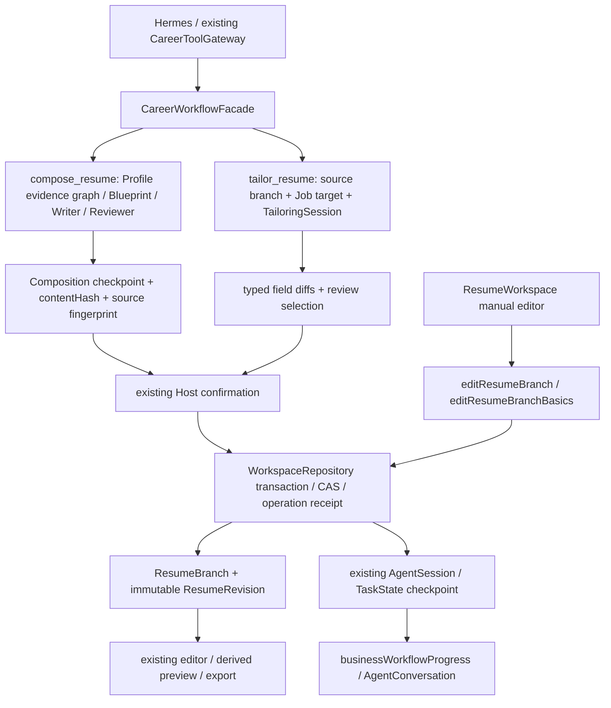
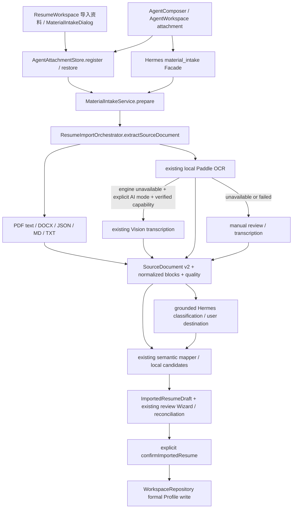

# P5.1-UX-01.3-AUDIT — Precise Second Editing & Image Material Workflow

日期：2026-11-06（Asia/Shanghai）。状态：**审计完成，实施未授权、未开始**。

本轮仅检查源码、测试、已有证据、依赖与上游资料，创建本报告并更新根目录交接。没有修改生产源码、测试、Schema、依赖或数据库，没有访问密钥、调用真实 Provider、启动浏览器回归、提交、推送或打包。Hermes 仍是唯一生产 Runtime；不新增 Workflow Engine、Multi-Agent 或 OCR 子系统。UX-01.2 保持 CLOSED WITH DOCUMENTED LIMITATIONS，UX-A 保持独立 PARTIAL，不自动处理 UX-A 或进入 UX-01.4。

## A. Git 基线与证据边界

| 项目 | 实际结果 |
|---|---|
| 分支 / upstream | `competition/5.1.8` / `origin/competition/5.1.8` |
| 本地 HEAD | `7e6cd06353a720a1d1e663f4b1932d92dc6df882` |
| 本地 origin tracking HEAD | `7e6cd06353a720a1d1e663f4b1932d92dc6df882` |
| 实时远程 HEAD | `git ls-remote origin refs/heads/competition/5.1.8`：`7e6cd06353a720a1d1e663f4b1932d92dc6df882` |
| divergence | `git rev-list --left-right --count HEAD...origin/competition/5.1.8`：`0 0`；实时远程同 SHA |
| 起始 working tree | `git status --short` 无输出；`git diff --stat` 无输出；diff check exit 0 |
| 最近提交 | `7e6cd06 UX-01.2-R` → `090f3da UX-01.2` → `37c5542 UX-01.1-R` → `d34f8a5 UX-01.1` → `874a03b RP-01.1` |

没有 fetch/reset/rebase/revert/覆盖本地成果。根目录 plan4/history4 的“尚未提交”以及旧报告的 remote SHA 是历史交付状态，不能覆盖本轮 Git 事实：UX-01.2-R 已在当前本地和远程提交内。

### 本轮读取的权威材料

- 根目录 `AGENTS.md`、`plan4.md` 当前交接、`history4.md` 最近相关交接。
- [P5.1 架构计划](CareerAdapt_AI_P5.1_Agent_Architecture_Development_Plan.md) P5.1.2/P5.1.3 及相关架构约束；其中“附件只有内存 Map”等旧原始步骤已被现行源码和 P5.1.2 交付更新。
- [UX-01.1 实施](p5.1-ux-01.1-profile-intake-jd-workflow.md)、[UX-01.1-R](p5.1-ux-01.1-r-closure.md)及候选/对账相关测试；UX-A 失败发生在测试过早读取任务状态，不能据此称材料后端不存在。
- [UX-01.2 实施](p5.1-ux-01.2-business-workflow-state-and-recovery.md)、[UX-01.2-R 收口](p5.1-ux-01.2-r-closure.md)、[机器证据 rCompletion](../quality/ux-01.2-implementation-evidence.json)、[最终 qualification-result](../quality/ux-01.2-r-logs/requalification-complete/qualification-result.json)、[Repository 回读](../quality/ux-01.2-r-logs/requalification-complete/repository-readback-check.json)和 `requalification-complete/browser.log`。
- [已有材料摄取交付](p5.1.2-material-intake-20261029.md)、[JD-03](p5.1-jd-03-job-specific-resume-tailoring.md)、[通用简历审阅](p5.1-resume-01-general-resume-quality.md)、[本地 OCR 配置及历史测量](../v2/P36_LOCAL_OCR_SETUP.md)，以及下文列出的实际源码和测试。

UX-01.2 的已有证据：原身份浏览器 1/1、约 1.5m、harness/Playwright exit 0；提案/失败/完成/取消均刷新恢复，正式分支和 Revision 从 1/1 到 2/2，Profile/来源分支不变；最终 118 项 0 skip 与 typecheck/lint/build 通过。这是**既有阶段证据，本轮没有重跑**，也不是 UX-01.3 的字段二改或真实图片质量认证。`rClosure` 的早期 PARTIAL 与 `rCompletion` 的最终关闭必须分开。

## B. 当前架构图与实际代码路径

### B1. 简历编辑有三条不同语义的路径

| 路径 | 实际入口与作用 | 二改审计结论 |
|---|---|---|
| 通用组装 | `src/agent/workflows/CareerWorkflowFacade.ts` 的 `ComposeResumeInputSchema` 和 compose 分支；`src/services/agent/agentToolService.ts` 的 `planResumeComposition` / `composeResume`；`ResumeEvidenceGraph.ts`、`ResumeBlueprint.ts`、`ResumeWriter.ts::compileResumeCompositionWithAi` | 从已确认 Profile 与证据图重建写作结果；sourceResumeId 是来源约束，不等于字段作用域。`reviewOnly` 已能只读审阅现有文本，但不能把组装解释成单字段补丁 |
| 岗位优化 | 同 Facade 的 tailor 分支 → 既有 tailoring service/commands → `src/domain/jobOptimization/tailoringDiff.ts::validateEachTailoringDiffLocally` → `src/services/storage/repositories.ts::deriveAndApplyTailoringDiffsAtomic` / `applyTailoringDiffs` | 已是类型化字段补丁；岗位目标和 job-specific 分支契约不能直接充当无岗位通用二改 |
| 手动编辑 | `src/app/resume/ResumeWorkspace.tsx::saveStructuredItem`、`saveBasicsPatch` → Repository `editResumeBranch` / `editResumeBranchBasics` → `mutateResumeBranch` | 可改结构化条目和事实字段；这是用户编辑语义，没有通用 AI 精确提案协议，不能直接暴露给模型写入 |

### B2. 目标定位的实际粒度

| 目标 | 当前来源 | 缺口/风险 |
|---|---|---|
| Profile | 活动 Career context、Session 绑定、显式 profileId；Gateway/ToolService 检查绑定 | “当前 Profile”不等于“当前简历”；禁止用活动 Profile 推断任意分支 |
| General Resume | 显式 sourceResumeId / UI activeBranchId；compose 的 update_existing 需要选择 | 已有选择保护；对话二改仍缺统一 scope |
| ResumeBranch | Repository 分支 ID、branchPurpose、profileId、jobId；Agent selectedEntities / 选择列表 | 不得按最新列表或最近创建分支猜测 |
| ResumeRevision | branch.currentRevisionId、source fingerprint、Task checkpoint；只读 revision 工具支持 revisionId | 当前 AI facade 未提供任意历史 Revision 的精确编辑契约；旧版本不能静默当成当前版本提交 |
| Job-specific Revision | TailoringSession 绑定 branch/job 或 targetSnapshot，并检查切换与 CAS | 已有岗位隔离；需要新增“编辑这个已选岗位版本”验收，不总是派生另一个分支 |
| section/item/field | TailoringDiff 的 sectionId（实际与 sectionType 对照）、itemId、fieldPath；编辑器 itemId / ResumeItemV2 | 与 UI 任意 section 实例 ID 不是当然同义；必须做 canonical 定位，不能拼路径 |
| 单条 bullet | ResumeFieldPatch 有可选 targetIndex，仅允许 highlights；TailoringDiff 的 target 没有 index，提交转换实际处理整个数组 | 缺端到端 bullet 作用域；有 index 类型不代表已接通 |

`src/agent/runtime/tailoringContextResolver.ts::resolveTailoringEntityReference` 被 `AgentTaskStateReducer.ts` 用于简历/岗位候选定位，支持 ID、唯一名称、序号和歧义结果。“刚才那个/上一个”返回候选排序末项，并没有独立的用户最近点选历史；不得扩张为可靠经历/字段/历史版本理解。没有证据证明任意自然语言都可稳定锁定一个字段。

### B3. 统一材料摄取已经存在

上图 CL 不是 Resume Center 的必经步骤：该入口用户已明确选择 Profile 材料，当前直接 `destination: profile`；Hermes 才按来源进行分类与路由。两入口共用服务和草稿，不表示两个 UI 都已有相同分类核对控件。

关键实码：

- `src/components/resume/import/MaterialIntakeDialog.tsx` 已提供专用“导入资料”、本地/AI 模式、上传、人工转写和 `ResumeImportWizard initialCreateGeneralResume=false`；`src/app/resume/ResumeWorkspace.tsx` 已挂载，不应再造一个材料入口。
- `src/services/agent/AgentAttachmentStore.ts`：8 MB、字节 hash、Session 所有权、同 Session 稳定 ID、Repository 原始 bytes、刷新 restore 与 hash 复核。Map 只是缓存。
- `src/services/materialIntake/MaterialIntakeService.ts::prepare`：恢复附件、统一 extract、保存 source/draft/extraction、返回 provisional candidates；`material-profile:<fileHash>:<normalizedTextHash>` 跨入口复用草稿；已确认返回 already_saved。
- `src/domain/materialIntake/materialIntake.ts`：12 类材料、profile/resume/job 候选目的地、confidence、歧义、blockId + 原 quote；`validateMaterialClassification` 检查引文确实在来源块中。它验证出处存在，不证明语义分类正确。
- `CareerWorkflowFacade.ts`：`career.workflow.material_intake` → `career.material.prepare`；profile 生成 resume_import_review checkpoint，JD 交 job_intake，简历交 resume_import。没有另一个材料 Runtime。
- `src/components/agent/AgentWorkspace.tsx` 已从 `open_import_review` 打开同一 `ResumeImportWizard`，material-profile 默认不建简历；确认后把正式结果送回 Host。`AgentHostStore.ts` 已有 material_intake → import Task 投影；`businessWorkflowProgress.ts` 已显示“正在读取材料”。
- `src/domain/profileReconciliation/ProfileReconciliationEngine.ts` 和 Repository `confirmImportedResume`：既有去重、冲突、证据扩充、草稿/对账/Profile 版本校验和正式确认。

## C. 能力矩阵

状态：已实现=已定位代码；部分=有基础但不满足完整要求；缺失=当前契约/路径无此能力；依赖阻塞=需可用外部模型/本地运行环境；未知=本轮及已有证据不能证明。代码存在不等于本轮测试通过。

### C1. Track A

| 要求 | 状态 | 证据与边界 |
|---|---|---|
| Profile/General/岗位分支定位 | 部分 | 上述绑定与 ID 已有；自然语言经历/字段定位仍需作用域与歧义确认 |
| 绑定明确 Revision，不取“最新即目标” | 部分 | fingerprint/CAS 已有；历史版本二改 UX 和通用 patch 输入缺失 |
| 只改一个项目 title | 缺失（AI 链） | `ResumeFieldPathSchema` 无 title；结构守恒明确保护 title。手动表单可以改，不是后端完全不能存 |
| 只改第一条职责 bullet | 部分 | highlights 是 string[]，实际 diff 传整数组，未锁定其他元素 |
| 添加一个已确认技能 | 部分 | Repository `createConfirmedSkillItem` 和 tailoring claim append 已有；通用无岗位二改入口/作用域缺失，不能通过伪造已有 itemId 绕过 target 校验 |
| 改日期/description | 部分 | description 已在改写目录；日期刻意不在 AI 改写路径，可走手动确认事实流程；两者不能共用宽泛 rewrite |
| 删除选定 bullet | 部分 | 基础 patch enum 有 remove，但 TailoringDiff 只有 replace/reorder/append/hide；可表达数组替换不等于安全单 bullet 删除流程 |
| 重排且不改写 | 部分 | 数组 reorder 检查 multiset；submission-safe 不接受 visible/order；编辑器的展示排序独立保存在 presentation config |
| 保留无关经历/section/顺序/来源 | 部分 | typed patch 和 spread 保留为基础；缺少精确 scope 的完整补集相等验证；compose 重建不能保证 |
| 模板/格式不变 | 已实现基础 / 二改待验 | Repository tailoring 有 presentation invariant；二改需固定 presentation fingerprint，不顺便应用模板默认值 |
| 分支身份/历史保留 | 已实现基础 | Repository 追加 Revision、previousRevisionId/operation 账本；精确二改不得总是派生新分支 |
| 事实/措辞/职责/成果分类 | 部分 | evidence graph claim classifications、Fact Guard、Claim Safety 和确认已有；新 AI 编辑契约须明确连接，不改阈值 |
| 精确 diff 与确认同一载荷 | 部分 | tailoring review/selection、composition contentHash 各自存在；缺通用作用域补丁的 hash/确认闭环 |
| stale CAS / 重复确认 / 拒绝不写 / 失败原文保留 | 已实现基础 / 新流程待验 | 原 Repository、确认回执与 UX012 恢复已有；不能直接继承成新流程已通过 |
| 取消及刷新恢复 | 部分 | 原任务恢复和 session fencing 可复用；尚无精确二改 proposal 的已认证恢复 |

### C2. Track B / C

| 要求 | 状态 | 证据与边界 |
|---|---|---|
| Resume Center 专用入口 | 已实现 | MaterialIntakeDialog；已有 UI 测试只验证 TXT review 入口 |
| Hermes 图片/文件附件 | 已实现 | 选择/拖放/缩略图/预览/队列/刷新来源恢复；生产不把 PDF/DOCX 作为 Hermes 原生文件发送 |
| 两入口同一 canonical 管线 | 已实现 | AttachmentStore → MaterialIntakeService → Orchestrator → ImportedResumeDraft → Wizard / Repository |
| PDF/DOCX/JSON/MD/TXT | 已实现 | 既有 PDF 文本提取、docx.ts ZIP/XML、json adapters、textDocument.ts；不需要新解析库 |
| 图片 / 扫描 PDF 识别 | 已实现适配 / 当前环境依赖阻塞 | OCR/Vision/人工核对路径存在；未证明本轮运行环境的 sidecar/模型可用 |
| 清晰证书、奖项、项目、实习证明语义质量 | 未知 | 规则/受控 OCR 响应有测试，真实原件/真实模型完整质量未认证 |
| 低质/旋转/多块截图 | 部分 / 质量未知 | Source blocks、bbox、quality 和 fallback 有；统一旋转校正/交互与质量矩阵未认证 |
| 原始 identity/hash/类型/抽取文本 | 已实现 | ref/hash/sourceDocument/sourceKind/rawText/engine/version |
| quote/page/region/confidence | 部分 | OCR 块有 page/position/confidence；Vision 行仅有 page/sourcePath，无 bbox，统一 0.5，不是校准概率 |
| 字段级证据与核验状态 | 已实现草稿 / 正式展示部分 | fieldCandidates 含 blockIds/ranges/quote/confidence/userConfirmed/reviewStatus；正式 FactProvenance 是较窄投影 |
| 可见/推断/待确认/不可辨认分开 | 部分 | 转写提示要求逐字和不可辨认占位；候选有确认状态，但不能机器证明“视觉可见”，也无统一四类 UI 语义 |
| 分类可建议、用户可纠正目的地 | 部分 | Hermes grounded classification 和现有工作流/对账可选；无统一12类分类纠错面板；Center 直接指定 Profile |
| 各领域基础/教育/经历/项目/奖项/技能/语言 | 已实现字段目录 / 分类质量未知 | canonical catalog 含 certificates 与 awards 独立类型；不能靠文件名或分类枚举证明映射正确 |
| 重复上传/重复证书 | 已实现基础 | file/text hash 草稿复用；对账 credential ID/实体 identity；OCR 文本变化和异文件同事实继续走对账 |
| 日期/描述冲突、同经历多文档、证据追加 | 已实现基础 | conflict/likely_duplicate/evidence_extension；不可把哈希去重当语义去重 |
| 部分识别/采用/编辑/拒绝/确认后落库 | 已实现基础 | 现有 Wizard 与 confirmImportedResume，不另建 Profile Intake；图片完整 E2E 待认证 |
| 原始资料→CareerProfile 不自动创建 Resume | 已实现默认 | 两入口 material-profile 默认 Profile-only；若用户另选创建简历须单独明确 |
| 进度/失败/取消/刷新/重复提交 | 部分 | 复用 UX012；Center 组件状态不是持久化任务目录，见 D3 |
| 不支持格式/抽取失败 | 已实现基础 | Orchestrator 类型限制、OCR 手工恢复、错误码与原始来源保留 |

## D. 根因与缺口分析

### D1. 精确二改缺的是作用域协议及提交约束

`ResumeFieldPatchSchema`、`ResumeTailoringDiffSchema` 在 `src/domain/schemas/tailoring.ts`：字段仅 text/name/description/highlights/visible/order；tailoring rewrite catalog 实际只允许 text/description/highlights，skills.name 是 creatable-only。日期、项目 title、组织、职责身份被刻意排除，`assertTailoringStructuralPreservation` 会检查这些结构字段未改。**不能为支持“改标题/日期”直接放宽整个改写 allow-list 或关闭守恒。**

此外有实际层间差异：`fieldCatalog.ts` 宣称所有条目 section 均有至少一个改写字段，`tailoringTargetCatalog.test.ts` 覆盖目录；但 Repository `applyTypedPatchToStructuredItem` 实际正文支持 summary、skills、project/work/internship，其他 section 的 description/highlights 会抛 `tailoring_field_path_not_allowed`。这是源码可见提交能力差异，不是缺浏览器测试；不要把 catalog PASS 当全 section 可写。本轮没有执行复现，不宣称已取得运行失败。

现行 `TailoringDiff` 无 bullet index，数组 replace 可以合法同时改多个 bullet。即使有整体 evidence/Guard，也不等于证明请求外元素没变。目标 item 的其余字段、其他 item 的事实引用、来源与内容排序需要补集守恒断言；现行结构守恒并非所有字段逐项比对。

通用 compose 基于 Profile evidence graph/Blueprint/Writer，不是以旧 Revision 为底的受限编辑。若把“改第一条”交 compose，旧简历独有且未同步 Profile 的内容可能重排、重写或失去。应保留组装语义，增补既有领域编辑工作流的精准模式，不能另造引擎。

### D2. 现有 CAS/幂等不可无条件等同“审核同一补丁”

- `applyTailoringDiffs`：事务检查 branchPurpose/jobId、expectedBranchRevision、expectedRevisionId，以及可选 Profile/Job 版本；校验 diff.original 与当前值，再生成新 Revision。确认/review 路径已存在，应复用。
- `ResumeCompositionCheckpoint.ts::createResumeCompositionCheckpoint`：contentHash 覆盖 graph/blueprint/writing/review/source fingerprint；不是字节文件 SHA，也不是新补丁的现成 hash。
- `mutateResumeBranch` 和 `applyTailoringDiffs` 的 operationId 重放会先返回已有操作结果；通用 helper 本身没有证明同 operationId 新载荷一定被拒绝。现有 Host 确认回执能约束原流程；新增编辑入口仍须绑定 proposalHash/target/baseRevision/operationId，增加错载荷重放负例，不在本轮顺便改公共幂等逻辑。
- `ResumeWorkspace::saveStructuredItem` CAS 冲突后回读最新分支并重试同一完整条目。这是现有手动保存策略；AI 已审核补丁不得套用该重试，否则可能覆盖用户刚改的同条目字段。精确二改必须 stale→停止→展示新差异→重新确认。
- `editResumeBranch` 可接受完整 structuredItem；其 Guard 主要依据 textChanged，且支持显式 resume-only 用户确认。它是正式手动入口，不是可把任意 AI structuredItem 塞进去的授权。新流程不得继承旧 userConfirmation 作为新事实的确认。

### D3. 材料链已有实现，主要缺可恢复定位、证据投影和质量资格

1. **Resume Center 刷新定位**：MaterialIntakeDialog 的 sessionId 用 useState 随机生成，attachmentId/importId/manualText 是组件状态，父组件开关还有 key 重置。来源和草稿虽已持久化，关闭/刷新后 UI 未持久化入口指针；重新上传同文件可复用草稿，但不等于无需重传恢复同一审核。建议用现有 appMeta/Session 引用保存可恢复定位，不新增表。
2. **来源与正式事实是分层保留**：SourceDocument 有 fileHash/sourceKind/page/position/engine/confidence，fieldCandidates 有 blockIds/quote/ranges；`ProfileReconciliationEngine::provenance` 对非 PDF 写 imported_text/sourceId=fileHash/fileName/sourceQuote，并设 confidence=0.9、confirmedByUser=true；没有直接携带每字段 OCR bbox 或 extractionConfidence。PDF 有 locator。这里的 0.9 是对账投影值，不能当 OCR 置信度；该函数构建待对账来源也不代表已正式确认写入。应沿 hash/草稿/sourceDocument 回溯展示原始识别信息，避免把已确认状态与视觉准确率混淆。若要求正式 Fact 内持有新结构，须先批准 Schema 变化，不默认迁移。
3. **人工转写身份关联**：Service 保留原文件 artifact.hash，并把 blocks 标 manual_transcription、confidence=0；fallbackDraft 来自 manual-transcription.txt。未来需验证 source draft、正式 provenance 和原 attachment hash 的可解析关系，不得声称 fallbackDraft 中原文件身份天然完整传播。不伪造 OCR 坐标。
4. **分类建议不等于已分类正确**：Hermes 12 类协议与 quote 校验已存在；Center 直接去 Profile。应把来源证据、建议目的地、用户纠正和不确定性接入现有审核，不再建“证书导入系统”。项目截图显示团队结果不能直接确认为个人负责；证书不应自动升级技能熟练度。
5. **撤销/取消边界**：OCR/映射取消可能留下合法 provisional 来源/草稿，必须与正式写入零变化分开。已成功提交后的取消不能回滚既有正式结果，复用 UX012 partial 语义。网络 abort 不保证 sidecar GPU 计算立即停止，不能承诺即时释放推理资源。
6. **草稿级去重不等于所有来源归属已认证**：跨入口同文件同文本共用 importId，首次保存的 draft source session 可能仍指向第一入口；另一个 Session 的附件所有权仍须独立校验。既有测试证明草稿复用，不证明任意跨人物目标/改目的地后的确认都安全，应补矩阵。

### D4. 事实类别与处理

| 修改类别 | 当前可复用机制 | 二改必须满足 |
|---|---|---|
| 已确认事实上的措辞 | verified / DERIVED_PRESENTATION、source refs、Guard、typed diff | 保留事实和未选内容，仍审核后确认 |
| 新技能/新日期/标题更正等事实 | user_declared / NEEDS_USER_CONFIRMATION、导入对账/手动确认 | 记录当前用户声明或来源；仅采纳措辞不自动确认新事实；无证据/确认保持 provisional |
| 参与→主导、团队成果→个人成果 | Claim Safety/ownership 与责任升级校验 | 原 Guard 拒绝仍拒绝；不能用“润色确认”包装权限升级 |
| 数字、证书、学位等硬事实 | sourceQuote/Fact refs、unsupported hard fact 拒绝 | 证据不足停下，补材料走统一 intake；未确认不进 Revision/预览/PDF |

## E. 最小实施切片建议（全部待用户授权）

建议保留 A/B/C 分拆，但 A/B 各自先做契约/现有能力复用的小步。**先 A，再 B，再 C**：A 的 proposal scope、不可变确认和 stale 处理是后续材料驱动二改所需基础；B 的原摄取能力已较完整，不应先投入新 OCR。

### UX-01.3-A：Precise Second Editing

1. **A0：先提交可评审契约**。定义明确目标（profileId、branchId、branchPurpose/job context、baseRevisionId/branchRevision、sectionType/itemId、canonicalFieldId、可选 bullet index + 原值）、before/after、证据/确认分类、proposalHash、operationId。编辑器选中值优先；自然语言唯一匹配才提出目标，歧义停止。历史 Revision 只作为明确基准展示，禁止静默写回当前头。Schema/确认载荷扩展若确实需要，先列变更并获批准后再编码；本审计不视为批准。
2. **A1：先接安全措辞子集**。复用现有 diff/Guard/确认/Repository，先覆盖明确 general/job-specific 当前分支的 description 与单条 highlights；Host 在原数组上合成唯一元素变化，补集必须相同，模型不得提供整份文档覆盖。新 proposal 使用原任务/checkpoint 存储和恢复，不建新状态系统。提交只为目标分支追加一条 Revision，返回权威 revisionId。
3. **A2：补要求中的事实编辑/新增/删除/重排**。项目 title/日期走专门的用户事实更正和证据确认路径，复用 canonical 字段与手动领域校验，禁止放宽 tailoring rewrite。技能创建复用已有 confirmed skill/去重。bullet 删除/重排由明确操作和原数组派生，不混合改写；展示排序复用 presentation config，单独描述其结果，不能假装产生正文改写。先完成端到端提交目录一致性，再宣称任意 section 支持。
4. **A3：审核与恢复**。原 inline diff/确认 UI 显示目标简历、版本、字段/第几条、前后文及证据；确认绑定完全相同 proposalHash 和 base，拒绝/取消不写；失败保留旧正式版本和提案；重复确认只回读一次结果；刷新恢复原提案且默认不重发写入。

复用：CareerWorkflowFacade/Gateway、AgentHostStore/TaskState、AgentTailoringInlineDiffs、tailoring validators、WorkspaceRepository Revision/CAS、业务进度和 Guard。修改：精确 scope 的领域契约/校验、现有工作流的精准入口/模式、Repository 受限提交及原 UI 选择接线。是否作为现有 facade 模式或单一领域编辑 facade，A0 依据 schema 评审确定；二者都不得引入第二引擎，也不得把无岗位编辑伪装成 target Job。

依赖：A0 的契约批准；A1 不依赖 OCR 或真实 Provider。验证：A 系列矩阵、target catalog→validator→Repository 对齐、Host 确认/重载/错载荷重放、一般/岗位隔离。风险：误用手动 CAS 重试、全数组覆盖、事实字段降级为 rewrite、旧 Revision 混用、AI 变更继承旧确认。验收：完整 A01–A16 及相关共享恢复项通过，所有补集相等且正式写入计数符合 G。

### UX-01.3-B：Image Material Intake 增量闭环

1. **B0：固定来源/路由契约与证据显示**。复用现有 MaterialIntakeService/SourceDocument/Mapper/Wizard，不新增管线；审核同时显示原图/原文、页/可用区域、候选 canonical 领域、quote、原始识别 confidence 与用户确认状态。无 bbox 明示仅页定位；不可辨认留空/待核对；用户能纠正证书/奖项/项目及目标 Profile/用途。
2. **B1：补入口恢复指针**。两入口保存并恢复同一 importId/draftRevision/attachmentId 与来源关联；Center 不再因刷新随机 Session 丢失入口定位；保持原 Session 所有权，不把 hash 当跨会话读取授权。重试恢复当前步骤，不重造草稿或自动确认。
3. **B2：正式确认和对账收口**。继续 `confirmImportedResume` / ProfileReconciliationEngine；采用/编辑/拒绝只改 provisional 草稿。明确冲突与额外证据动作；同文件、不同图同事实、多文档同经历、已有 Profile 冲突均回读验证。人工转写引用原图但标注用户转写，不偷换原文。
4. **B3：质量资格单独分层**。先受控 OCR/Vision 响应验证协议，再用匿名固定图片及已可用本地能力测量。若 OCR 环境未具备，标 BLOCKED/未认证，协议闭环可以单独交付。真实 Provider 仍须用户另行授权；不得为获得质量成绩自动读取 Key 或发送材料。只有现有能力明确不满足时才提交替代引擎比较与依赖审批。

依赖：A 的确认约束可复用；材料→Profile 核心可独立验证，不应捆绑重新生成整份简历。只有用户明确要求材料用于二改时才进入 A 的新 proposal。风险：误把识别 confidence 当可信事实、Center 刷新丢指针、同哈希跨目标草稿复用、来源断链、团队成果越权归因。验收：B01–B17、X01–X05；真实质量与模拟协议结果分别报告。

### UX-01.3-C：Integrated Qualification

复用锁定 Hermes + 本地 Scripted Provider + 真生产组件/Host/Gateway/Repository；不修改 Hermes defaults，不另建工作流。小量定向浏览器串起选定条目二改→审核→拒绝/确认→正式结果刷新，以及上传证据→核对→Profile-only 保存→用户明确发起简历二改。故障组合大部分用单元/集成，浏览器仅代表路径，避免广泛回归。

依赖：A/B 各自门禁完成及必要契约批准。相关 typecheck/changed lint/Unit/Integration/build、少量定向 Playwright、必要局部 UI 截图、diff check。只有实际影响的预览/PDF 做选定版本输出检查，不进入全模板 Release Gate。验收：矩阵所有本切片承诺项有完整退出码；证据给出来源/分支/Revision/hash/确认/操作与正式写入数量，不用 Run completed 或模型文字代替业务结果。无真实识别条件时保持显式质量限制，不宣称完整图片质量通过。

## F. 架构影响与审批门禁

| 范围 | 预计文件/契约（不是本轮修改清单） | 约束 |
|---|---|---|
| 目标/精确补丁 | `src/domain/schemas/tailoring.ts`、`src/domain/resumeFields/fieldCatalog.ts`、`src/domain/jobOptimization/tailoringDiff.ts`、`src/domain/resumeIntegrity/tailoringStructuralPreservation.ts` | 现有 schema 不足以表示 title/date/端到端 bullet scope。优先复用；必要新增领域输入/提案契约先批准，不改 Resume Schema v2 正文模型 |
| 工具/业务接线 | `CareerWorkflowFacade.ts`、`CareerToolGateway.ts`、`registry.ts`、`agentToolService.ts`、相关 JSON Schema/工具目录测试 | 只增加明确领域能力；不改变 Runtime，不静默暴露手动写接口 |
| 确认/恢复 | `AgentHostStore.ts`、`AgentTaskStateReducer.ts`、`businessWorkflowProgress.ts`、既有 session/action/checkpoint 契约 | proposalHash 绑定原确认；延续 UX012 TaskState/回执，不新增平行进度表或引擎 |
| Repository | `src/services/storage/repositories.ts` | 所有正式写入、CAS、幂等、revision lineage 仍在此；不得浏览器组件直接 put；现有 appMeta 可保存 provisional 引用 |
| 编辑 UI | `ResumeWorkspace.tsx`、`AgentTailoringInlineDiffs.tsx`、`AgentConversation.tsx` | 只补目标/局部 diff/确认，保留视觉语言与模板；不做全站重构 |
| 材料 UI/来源 | `MaterialIntakeDialog.tsx`、`ResumeImportWizard.tsx`、`AgentWorkspace.tsx`、`MaterialIntakeService.ts`、`AgentAttachmentStore.ts`、materialIntake.ts | 共用原管线，补指针恢复/纠错/来源回溯；非默认重建附件存储 |
| 对账/证据 | `ProfileReconciliationEngine.ts`、sourceDocument.ts / mappingValidation.ts / 既有 review projection | 首选从已存 SourceDocument 解析 bbox/原始 confidence；若需要扩展 FactProvenanceSchema，先审批，不能假装已有 |
| OCR/图像 | `ResumeImportOrchestrator.ts`、visionExtraction.ts、ocrAdapter.ts、现有 API 与 sidecar | 仅有实测不足才修改；不新增引擎、不下载模型、不假定 localhost 已就绪 |

**Schema**：本轮零变化。实现可能需要精确提案/确认 payload 或 Session checkpoint 的兼容扩展，必须在 A0 说明并获批准；保持 CareerProfile v2 / Resume Schema v2。**表/迁移**：当前设计无需新 Dexie 表，无已批准迁移；若实现发现必要应停止另报。**Guard**：阈值零影响，事实更正与措辞分开而非放宽 Guard。**Runtime**：Hermes、Supervisor/Browser Domain Host/MCP ownership 不变，不新增 Planner/Native fallback。**依赖**：推荐零新增生产依赖。**确认/CAS**：新补丁须加强作用域绑定，不能改变旧 UX012 的已认证语义。

## G. 验收设计：既有覆盖与未来矩阵

### G1. 已有覆盖，未在本轮重跑

| 现有测试/证据 | 可证明的覆盖 | 不能外推 |
|---|---|---|
| `tests/unit/tailoringFieldSafety.test.ts`、`tailoringDiff.test.ts`、`tailoringTargetCatalog.test.ts` | 字段类型、claim、原值不符/身份限制、重排 multiset、目录 | 不能证明所有 section 的真实 Repository 提交或自然语言单 bullet 编辑 |
| `tests/unit/jd03TailoringIsolation.test.ts`、`repositoryTailoringV2.test.ts` | 岗位隔离、选择应用、拒绝/未决阻止、重复操作及 lineage | 不等于通用无岗位精确二改 |
| `tests/unit/resumeCompositionConfirmedWriteP45c12.test.ts` | 原确认/恢复、重复、stale checkpoint、update_existing 显式选择 | 是 compose，不证明 patch scope |
| `tests/unit/p512-material-intake.test.ts` | 原始字节恢复/所有权/hash、真实 DOCX parser、模拟 OCR bbox/低 confidence/多页、人工转写、跨入口草稿复用、正式 Profile 确认/重复 | 不能证明真实图片识别准确率或所有浏览器交互 |
| `tests/unit/profileReconciliation.test.ts` | 重复/冲突/证据追加/多来源、Profile stale 与两客户端同一计划 | 不等于图片分类与用户纠正都已认证 |
| `tests/unit/resumeVisionImport.test.ts`、`resumeOcrAdapter.test.ts` | 受控 Vision/OCR 协议与错误处理 | 不等于真实 Provider 或当前机器 OCR 可用 |
| `tests/e2e/p512-material-intake.spec.ts` | TXT 材料→共享 review/Profile-only 默认；对话附件预览/刷新/移除及图片缩略图 | 不包含真实图像识别→核对→Profile 正式落库完整链 |
| UX012 rCompletion / complete logs | 已保存结果、失败恢复、确认刷新和取消的原业务层约束 | 不新增 A/B 的浏览器通过数；不重开 UX-A |

### G2. 未来验收共同计量规则

每个案例保存 before/after 正式 Profile、目标/非目标 Branch、Revision 列表、presentation config、proposal/hash/base、operation 与 receipt。正式确认前允许 appMeta/来源/草稿改变，**Profile/正式 Revision/预览/PDF 不得吸收候选**。成功内容修改恰好新增目标分支 1 条 Revision，Profile 不变（材料明确入库案例除外）；拒绝/stale/失败/取消提交前均新增 0 条。重复提交对同一 proposal 累计仅 1 条；错载荷复用 operation 必须拒绝，不得返回误绑定成功。展示排序若只修改 presentation，按展示版本验收，正文 Revision 不应被误计为成功二改。下表全部为**未来设计，未执行，不标 PASS**。

| ID | 场景 | 精确预期业务结果 | 层级 |
|---|---|---|---|
| A01 | 通用简历只改某项目 description | 仅指定字段变化；所有其他 item/字段/顺序/来源引用/模板相等；目标 +1 Revision，Profile 不变 | Unit+Repository+定向 UI |
| A02 | 只改第一条 responsibility bullet | 只有指定 highlights[index] 改变；其余数组元素逐值、逐序相等 | Unit+Repository |
| A03 | 选定岗位分支某 item 编辑 | 只该 branch 增加 Revision；通用/另一个岗位/Profile 均不变，job 绑定和 lineage 保持 | Repository+定向 UI |
| A04 | 项目 title / 日期更正 | 明示事实更正及其来源/本次用户确认；未确认零写，确认后只改目标字段；不能调用 rewrite 放行 | Unit+Host+Repository |
| A05 | 添加一个已确认技能 | 去重后只新增该技能；已有 skills 不变；不默认同步 Profile | Repository |
| A06 | 删除选中 bullet | 仅删该 index 的原值，其他元素及来源引用保持；不存在/原值变更拒绝 | Unit+Repository |
| A07 | 选中内容重排 | 成员 multiset 不变、不改文案；只改声明的正文或展示排序，明确是哪类保存 | Unit+Repository |
| A08 | 同名项目/“刚才那个”有歧义 | 展示候选并等待明确选择；零正式写、不选列表末项作为隐式授权 | Reducer+Host+Component |
| A09 | 引用非当前历史 Revision | 明确展示基准与当前差异；未选择处理方式不得覆盖当前头，零写 | Host+Repository |
| A10 | 审核后拒绝 / 取消 | 原 Revision/hash/Profile 不变；提案记录拒绝/取消，刷新不复活可提交动作 | Host+Component+定向 UI |
| A11 | 无证据新增数字/主导/个人成果 | 被现有 Guard/证据规则阻断或停待补证；确认措辞不得绕过事实确认；预览/PDF 无该事实 | Guard+Repository |
| A12 | 正常确认、双击、并发重复 | 同 proposalHash/base/operation，目标累计仅 +1 Revision，回读相同权威 revisionId | Repository+Host+定向 UI |
| A13 | 审核后用户手改同条目，发生 stale CAS | 拒绝旧 proposal；不自动回读重写完整 item；用户新内容不丢，重新审核才可再提交 | Repository+Host |
| A14 | proposal 后/确认中刷新，网络中断或落库失败 | 恢复原 target/base/hash；未提交零写，已提交按 receipt 回读，不重造或重复应用；旧内容可打开 | Host+Repository+定向 UI |
| A15 | 同 operationId 换 payload/target 或切 Session 后迟到回执 | 拒绝错载荷与目标；迟到回执不覆盖当前会话，零额外写 | Gateway+Host+Repository |
| A16 | 目录声称支持的每个 field/section | 实际 validator→Repository 往返一致；不支持的字段在提案前明确拒绝，不能到提交才失效 | 参数化 Unit+Repository |
| B01 | 清晰证书图片 | 转写、证书类型/颁发方/日期候选、原文件 hash/引文可回溯；审核前零正式写 | 受控协议+真实质量分开 |
| B02 | 低质、旋转图片 | 不能辨认字段留待核对，不编造日期/姓名；保留原件并可人工转写/重试 | Adapter+UI+质量集 |
| B03 | 多块截图含证书/岗位/项目 | 保留块与顺序；mixed/歧义可纠正目的地，不能整个截图强制写成一个经历 | Service+Host+UI |
| B04 | 奖项图片 | 映射 awards，原 quote/page/可用 bbox 可回溯，不自动当 certificate 或 skill | Mapper+Review |
| B05 | 项目截图含团队指标 | 个人职责不明则待问/待确认，不把团队成果当本人主导；拒绝后正式数据无该 claim | Guard+Review |
| B06 | 同文件两入口重复上传 | 同 bytes/text 复用 canonical draft；确认一次后再传返回 already_saved，Profile 不重复新增 | Service+Repository+跨入口 UI |
| B07 | 不同文件描述同证书/同经历 | 走实体对账与 evidence_extension；不覆盖已确认事实，新增证据可回溯两个来源 | Reconciliation+Repository |
| B08 | 与 Profile 日期/描述冲突 | 冲突显式显示，deferred 未决阻止提交；按用户选择保留或更新，来源链不丢 | Repository+Review |
| B09 | 拒绝候选 | 只更新草稿选择，正式 Profile/Resume 不出现该候选，确认其他项也不夹带 | Review+Repository |
| B10 | 编辑抽取候选 | 保存用户修订与原始 quote 分开；新增事实须当前确认；不能把用户修改伪装原图可见 | Review+Repository |
| B11 | 明确保存到现有 Profile | 对账/草稿/Profile CAS 有效才提交；正式 Profile version +1、回读命中；默认 0 新 Resume Revision | Repository+定向 UI |
| B12 | 审核中刷新 | 两入口均恢复同 importId/revision/来源及已编辑/拒绝状态；不要求重新上传，不自动确认 | Component+定向 UI |
| B13 | 不支持格式、损坏文档、超8 MB、空内容 | 显式错误，零正式写；可恢复输入保留，限制与能力清单一致 | Adapter+Component |
| B14 | OCR 不可用 / Vision 能力未知 | 不向未知模型发送图片；manual_review 保留原件；当前人工转写来源标记与 confidence=0 可见 | Service+API mock |
| B15 | 处理中取消、确认写失败 | 取消前未正式保存则零写；合法临时来源可留；失败可同草稿恢复且不会重复正式事实 | Host+Repository |
| B16 | 人工转写后正式确认 | 可从正式事实回溯原附件与转写草稿；不伪造原始 filename/hash/bbox/confidence；标清用户转写 | Service+Repository |
| B17 | 同 hash 换目标 Profile / 换用途 | 草稿复用不绕过新的目标确认及对账；已保存其他人物不能误报当前人物保存成功 | Service+Repository |
| X01 | Center 与 Hermes 上传同固定图片 | 同一解析/映射/审核/确认实现；source blocks 和规则语义相同，Session 所有权各自有效 | 跨入口定向 UI |
| X02 | 在审核中纠正证书/奖项及 Profile/resume/job | 建议可改；目的地不同使用原对应确认契约，旧错误目标不写 | Host+Component |
| X03 | 上传补证后明确要求某简历单字段编辑 | Profile 入库与 Resume patch 两个明确动作；各有确认；未要求同步则不隐式反向写 Profile | Host+Repository+定向 UI |
| X04 | 已保存后 Run 取消/失败与刷新 | 业务 partial、正式结果保留，不能标为回滚，也不能额外应用未确认候选 | UX012 复用+定向 UI |
| X05 | 已确认结果打开编辑/预览/选定 PDF | UI/导出使用权威 revisionId；未确认事实完全不出现，非目标内容与模板守恒；不宣称全模板认证 | 定向产物检查 |

真实图片质量资格：选固定匿名原件，人工逐字段标注真值与不可辨认字段，记录关键身份/日期/证书编号准确性、漏识别/虚构、类型/目的地正确性、耗时、峰值资源；OCR 与 Vision 分开。没有用户批准的质量阈值时不自设“95%通过”等产品门槛；**未经确认零正式写、不可辨认不编造、责任不越权**是必须满足的安全业务结果。

## H. 识别方案、开源复用与剩余问题

### H1. 当前可用路径与资源

| 选项 | 当前实际情况 | 成本/准确率与决定 |
|---|---|---|
| 数字 PDF / DOCX / JSON / MD / TXT 原生解析 | 已安装并接线；DOCX 是现有自有 ZIP/XML parser，不需要 mammoth | 优先原生提取，保留来源；文档内嵌图片不等于已递归 OCR，不能承诺任意附件图片抽取 |
| 既有 PaddleOCR-VL sidecar | `ocrAdapter.ts` → `/api/resume-import/ocr` → localhost sidecar；Python/模型是独立部署 | 历史文档约7.9 GB显存/单页热推理37秒是旧环境测量。本轮 PATH Python 用 importlib 只读检查 paddle=false、paddleocr=false；不是所有外部 venv 都不存在。未读 env/模型目录、未启动 sidecar，当前配置可用性未知 |
| 既有多模态 Vision | OCR engine_unavailable 且 AI 模式才查明确 image 能力；未知则人工；`visionExtraction.ts` 原有 PDF render/图像缩放/JPEG 转写 | 无新增依赖；资源在 Provider，需明确外发许可/已配置能力；本轮真实请求0。page 可保留，bbox 不提供，confidence=0.5 是保守值；不声称真实准确率 |
| 已有图像预处理 | canvas 最大边1800、白底、JPEG0.9，PDF 最大5页，入口8 MB | 可减少传输；小字/印章可能受缩放损失，旋转/透视效果未知；先测样本，不默认新增图像库 |
| 手动对照转写 | 已实现，原件保留，sourceEngine=manual_transcription、confidence=0 | 模型不可用时可继续审核；转写不是可见证据已验证的证明 |
| 本机 Tesseract | 只读发现 `pytesseract` Python 模块和 PATH `tesseract.exe`；未运行推理、未检查语言包/版本 | 存在不等于已集成或适合中文材料。不建议直接新增接线；仅现有能力实证不足时，另批准本机版本/许可/语言包和 benchmark 调查 |
| OpenDataLoader 实验 API | 仓库已有 localhost adapter/route | 未核实部署，数字PDF已有主路径，不作为默认新依赖或 OCR 替代 |

### H2. 固定版本上游核查与复用机会

2026-11-06 通过上游官方源码/License/发布页只读核查；没有安装或复制组件。下列版本用于可复核比较，不声称为最新。维护状态只表示有官方源码/发布活动可查，未进行完整漏洞审计。

| 项目 / 固定版本 | 许可与相关源码 | 维护/集成机会 / 风险与结论 |
|---|---|---|
| [Mozilla PDF.js v5.4.296](https://github.com/mozilla/pdf.js/tree/v5.4.296)，本机 pdfjs-dist package 实际5.4.296 | [Apache-2.0](https://github.com/mozilla/pdf.js/blob/v5.4.296/LICENSE)；[src/display/api.js](https://raw.githubusercontent.com/mozilla/pdf.js/v5.4.296/src/display/api.js) | 官方[发布页](https://github.com/mozilla/pdf.js/releases)有后续版本；继续复用已安装 text/render API，不升级。worker 打包、恶意PDF与尺寸资源限制仍须保留；本机包要求 Node >=20.16 或>=22.3，不能只看项目宽泛 >=20.9 声明 |
| [Tiptap v3.27.3](https://github.com/ueberdosis/tiptap/tree/v3.27.3)，本机 @tiptap/react 实际3.27.3 | [MIT](https://raw.githubusercontent.com/ueberdosis/tiptap/v3.27.3/LICENSE.md)；[packages/react/src/useEditor.ts](https://raw.githubusercontent.com/ueberdosis/tiptap/v3.27.3/packages/react/src/useEditor.ts) | 已安装的编辑交互组件可继续使用；selection transaction 不等于 canonical item/field identity，SSR/selection→领域坐标必须明确映射。无须添加新富文本或 diff 依赖 |
| [PaddleOCR v3.7.0](https://github.com/PaddlePaddle/PaddleOCR/tree/v3.7.0)，与项目配置文档版本一致；模型名 VL-1.6 | [Apache-2.0](https://github.com/PaddlePaddle/PaddleOCR/blob/v3.7.0/LICENSE)；[paddleocr/_pipelines/paddleocr_vl.py](https://raw.githubusercontent.com/PaddlePaddle/PaddleOCR/v3.7.0/paddleocr/_pipelines/paddleocr_vl.py) | 官方管线维护且支持 orientation/unwarping 参数；这些上游参数不证明当前 sidecar 已启用。Python/Paddle/CUDA/模型权重部署与许可证/校验另核；先利用现有 adapter，不新增第二引擎 |
| [Tesseract.js v6.0.1](https://github.com/naptha/tesseract.js/tree/v6.0.1)，只作备选比较，未安装 | [Apache-2.0](https://raw.githubusercontent.com/naptha/tesseract.js/v6.0.1/LICENSE.md)；[src/worker-script/index.js](https://raw.githubusercontent.com/naptha/tesseract.js/v6.0.1/src/worker-script/index.js)、[README](https://raw.githubusercontent.com/naptha/tesseract.js/v6.0.1/README.md) | 官方 README 有维护标识，[发布页](https://github.com/naptha/tesseract.js/releases)可查；浏览器/Node WASM，不直接支持PDF。若接入会新增 worker/WASM/语言包/CSP/离线分发及内存开销，中文/旋转材料准确性无本项目测量，当前不推荐引入 |

不需要新 workflow/diff/OCR 框架：已有 typed patch、inline diffs、Repository、source blocks 与 review 足够作为实现基础；缺少的是领域目标约束，不能交给通用编辑组件自动解决。PDF.js、Tiptap、Paddle、Tesseract 各上游的短摘要仅描述对应链接中的能力，不构成当前产品能力认证。

### H3. 仅剩需要额外证据或用户决策的问题

1. A0 精确提案/确认输入的最小 Schema 扩展，以及 title/date 用户事实更正的具体授权契约，是否批准进入实施评审？不需要改正文 v2 或新表，但现行 TailoringDiff 无法完整表达全部请求。
2. 明确选中历史 Revision 后，产品允许“基于旧版本生成独立分支”，还是只允许展示后让用户先切换/恢复？当前源码不能替用户决定该产品交互；首切片可安全拒绝历史写入。
3. 真实识别资格使用哪些匿名材料、哪种已可用环境、哪些字段准确率门槛？本轮不能确定外部 venv/本地模型的实际就绪状态，也未授权真实 Provider/密钥访问。
4. 正式事实是否要求直接持有图片区域/识别 confidence，还是从已保存来源草稿回溯即可？现有后者可减少 Schema 影响；若前者为硬需求须单独批准 Schema/兼容方案。

本轮没有等待这些问题而停止调查；上述是实施/真实质量的决策点。用户下一步只需选择授权切片，不能将本报告当 A/B/C 连续实施授权。

## 审计交付与验证记录

- Git/源码/测试/历史证据及固定版本上游只读检查完成；局部不存在路径的搜索已改用真实文件定位，不将搜索失败当产品缺陷。
- 本轮不运行 typecheck、Unit、build 或浏览器：纯审计/文档无产品变化，符合 AGENTS 文档模式；已有测试结果均明确标为历史证据，G2 全部未来设计。
- 最终仅本报告和被 Git 忽略的 plan4/history4 交接改变；以最终 Git status/diff check 和文件回读核验。无提交/推送/打包；无文件删除；无生产修改。
- 下一步建议：用户评审后仅授权 UX-01.3-A 的 A0/A1，再按验收范围推进；本轮到此停止。
