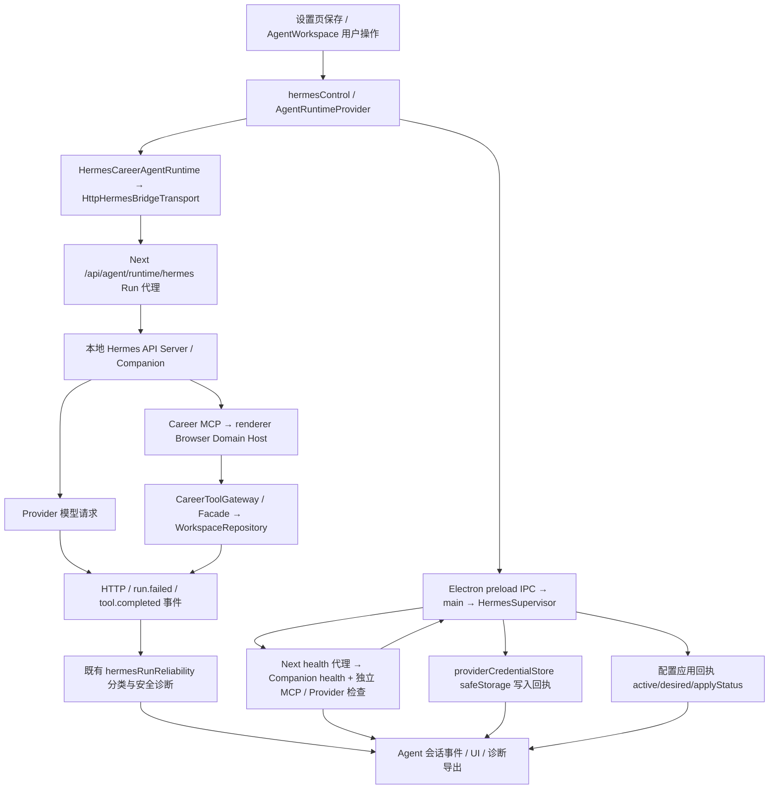

# P5.1.1 / R2-OBS-01：错误诊断与状态可观测性

日期：2026-10-28。代码基线：`37635cfb25872931a3ebd293e41e353a20b6678c`（包含用户给定 `e07c617` 及后续证据归档提交）。开始时 `git status --short` 为空；原 A03、P5.1 计划与基线审计均已提交存在，未覆盖。最终证据 JSON、R2 handoff、P5.1 计划均已读取；没有缺失文件。尚未提交、未推送、未打包。

## 修改前实际链路



图中是运行与返回依赖关系，不表示每次操作都会经过 Provider、MCP 和写入。设置凭据走真实 IPC；浏览器 Run 走 Next 代理；Hermes 实际执行模型请求。凭据写入、配置应用和运行状态本来就是独立回执。

### 各层错误职责与已存在能力

- 系统凭据边界：`electron/main.js` / `providerCredentialStore.js` 返回 available/configured/source/reason；写入结果的 ok 与其 control.ok 分别表示写入和应用结果。本轮没有修改存储。
- 配置和进程边界：`electron/hermesSupervisor.js` 已分别维护 processReady/apiReady/providerReady/careerMcpReady/toolSurfaceReady/runReady 及 runtimeConfig；READY 仍要求完整门禁。没有重写状态机。
- 请求边界：`src/app/api/agent/runtime/hermes/route.ts` 把控制服务 HTTP 401/403 标为 control_plane；`HermesBridgeTransport.ts` 解析桥接结果和官方 SSE。`run.failed` 使用结构化 HTTP 字段；工具失败事件区分业务失败和成功 envelope。
- 分类层：`hermesRunReliability.ts` 已有 failureLayer/httpStatus/safeErrorCode/upstreamErrorCode/category/关联 ID；Runtime catch 合并该对象，不需要另建错误架构。
- MCP / 领域边界：`CareerToolGateway` 与 Facade 返回结构化结果；业务 code 必须保留。`tool.completed` 不能仅凭事件名称视为成功，现有 success envelope 判定保留。
- UI / 导出：`hermesControl.ts` 已分别投影 Provider/MCP/配置；`AgentWorkspace.tsx` 已从 activeTurn 或 runtimeHealth 读取并清洗 runtimeFailureDiagnostics 导出，保留首次故障快照。无需新增表或诊断持久化。

## 实际问题与修复

| 证据 / 修改前断点 | 本轮改动 | 验证 |
|---|---|---|
| 分类器读取 message 中 auth/credential/HTTP 等文本推测原因，缺乏可信结构化证据 | 去掉自由文本分类及 HTTP 推断；认证要求 Provider 层/明确机器码；控制认证独立；添加凭据不可用、Provider HTTP/429、请求超时类别 | 未知错误正文含 API key、timeout、HTTP 429/401 仍不被归因为凭据或相应状态 |
| Provider 连接码包含 connect 时可被改成 Companion 故障；Provider HTTP 被归并桥接失败 | Provider 层保留；429/其他 Provider HTTP 保留真实层与状态 | Provider 连接/401/429、桥接401、超时测试 |
| bridge jsonRequest 和 streamRequest 用外层 HTTP 与桥接层覆盖内层诊断 | 保留结构化 diagnostics 的 HTTP/层；JSON 也接受 error.httpStatus | 502 envelope 内 Provider 429 在 JSON/SSE 请求入口均保留 |
| tool.completed 的 result.code 没有读取；错误 message 直接返回 | 读取实际错误记录 code，复用已有脱敏分类路径；业务安全码保留 | revision_conflict 不丢失，Authorization 测试密钥不出现在事件 |
| health proxy 的宽泛 catch 统一 unreachable，且给 Provider 标 unreachable，丢弃异常底层证据 | 白名单保留 cause.code / TimeoutError；Provider 状态 unknown；无法证明连接故障时 health_check_failed/unknown；不输出异常正文/栈/请求头 | 实际 GET 路由受控 fetch ECONNREFUSED 返回503，诊断保留安全码；未知异常/超时独立测试 |
| 设置页只有 applied 才刷新凭据状态，写入成功但应用失败时用户仍可能看到旧状态 | 收到存储回执立即更新凭据状态并清空输入；独立展示存储、配置应用、Companion、Provider、MCP | 浏览器真实设置页在 failed/degraded 合成依赖下保存成功，状态立即分别展示；未注入 READY |
| Companion unreachable 缺少明确反馈，未知配置错误泛化成检查 Key | 复用 humanHermesReason，补 Companion/凭据/429 提示，未知错误提示查看回执；保存 catch 不输出原始异常 | 状态投影与浏览器断言 |

自由文本只作脱敏说明，不再决定根因。新网络诊断只输出白名单机器码，不复制异常 URL、正文、headers 或 stack。增加引号形式凭据配置脱敏测试；没有采集真实密钥。retryable 仍是既有元数据，本轮未增加重试执行、队列或限流。

## 修改文件

- `src/agent/runtime/hermes/hermesRunReliability.ts`：扩展原有枚举和证据分类、底层安全诊断与脱敏。
- `src/agent/runtime/hermes/HermesBridgeTransport.ts`：保留内层 HTTP/阶段与工具业务码，工具失败说明脱敏。
- `src/app/api/agent/runtime/hermes/health/route.ts`：保留系统错误码，避免 Companion 故障推断 Provider 故障。
- `src/services/agent/hermesControl.ts`：复用反馈映射，增加独立凭据说明。
- `src/app/settings/page.tsx`：立即消费存储回执，显示独立运行状态，避免原始异常输出；仅文本与状态反馈，没有重设计 UI。
- `tests/unit/p511-r2-observability.test.ts`：21 项定向用例（含参数化），覆盖用户八项情形、真实健康路由及桥接状态保留。
- `tests/unit/p45c17-hermes-reliability.test.ts`：原认证失败夹具增加明确 Provider 层；原断言、用例和重试次数要求不变。
- `tests/e2e/r2-observability.spec.ts`：1 条实际页面反馈测试，依赖受控且始终 degraded/failed，无 READY 事件。
- 当前报告、R2 handoff、plan4/history4：交接与验收记录。

## 验证与限制

修改前：`pnpm typecheck` 退出0；p45c17 与 hermesControlCapability 两文件18项退出0。

最终定向集合：

```powershell
pnpm exec vitest run tests/unit/p511-r2-observability.test.ts tests/unit/p45c17-hermes-reliability.test.ts tests/unit/p45c1c12-hermes-incident-trace.test.ts tests/unit/p45c1c13-hermes-long-run-semantics.test.ts tests/unit/hermesControlCapabilityP45c123.test.ts tests/unit/p46c6-ai-runtime-configuration.test.ts tests/unit/p45b4-hermes-mcp-closure.test.ts
pnpm exec playwright test tests/e2e/r2-observability.spec.ts --workers=1
pnpm typecheck
```

相关 Vitest 7文件63项退出0；Playwright 1项退出0（3.9s，整体5.6s）；changed-files ESLint 与 git diff --check 退出0。最终 `pnpm typecheck` 退出0；修正 AsyncIterable 测试类型后新文件21项复跑退出0。

过程失败保留说明：首次实现测试发现清除文本推断后残留 message 引用，已修复；类型检查发现一处不可达比较和测试 AsyncIterable.next 类型用法，已修复。首次浏览器45秒超时因首次使用引导挡住设置，按正常入口点击“跳过”后通过，未改生产引导/READY；首次 diff 检查发现写入造成 CRLF 噪声，恢复原 LF 后局部 diff。没有删断言、skip 或降低阈值。

未运行全量回归/build/实际 Hermes 会话/真实 Provider 认证/Electron 恢复/坏密文/正式包；本轮为诊断和反馈工作包，结果不能替代上述真实运行验收。没有再次执行 R1 或90秒 READY循环。

## R2-RDY-01：独立 OPEN

历史真实证据仍是最终 R1 JSON：凭据恢复 PASS，configured/available=true、source=secure_store；运行时 degraded/hermes_companion_unreachable、providerReady=false、careerMcpReady=true、applyStatus=idle。本轮没有重新采集该故障，也没有确定它的网络、鉴权、进程或时序根因。测试 ECONNREFUSED 只验证传播，不回填为历史真实原因。

源码已知：

1. `electron/hermesCompanion.js:resolveRuntimeConfig` 以 HERMES_RUNTIME_URL 或默认 `http://127.0.0.1:8642` 为根；本地端口冲突时 `allocateLocalRuntimeUrl` 在有界扫描内顺延。`electron/main.js` 分配后更新环境；开发服务复用时还可能取已有服务 health.runtimeUrl。必须比较实际最终值，不能只看默认端口。
2. Electron 等 renderer-ready IPC 后启动 Supervisor；Companion 先 probe 已有服务/启动进程，再有界等待 health；Supervisor 随后通过 Next `/api/agent/runtime/hermes/health` 同步工具面。Next 再请求 Companion `/health`（仅404时兼容 `/api/health`）。存在多个交接时刻，但源码顺序不能证明竞态已经发生。
3. Companion 自身 probeHealth 仍会吞连接异常细节；本轮没有改启动探测。Next health 代理现在能保留底层白名单原因并通过既有 runtimeHealth 诊断导出。旧证据缺少这些信息，无法逆推。
4. MCP 的浏览器连接、服务器可达性和工具注册与 Provider/Companion 分开；MCP=true 不代表模型请求或完整 Run READY。

后续诊断条件与停止点（待用户单独选择 R2-RDY-01）：在同一个实际失败进程存活时，单次取得 Supervisor runtimeUrl、Next 实际代理目标、分配端口及监听 PID/进程存活、renderer-ready/启动/首个 health 时间戳。只作一次有界鉴权 health 探测（兼容路径仅404追加），记录 HTTP 状态或白名单 cause.code、鉴权是否配置的布尔值，不记录 Key/header/body。对比地址与归属后再决定唯一下一假设。信息不足即保持 OPEN；不重跑凭据保存/模型切换全链、不启动 READY 循环、不修改门禁或启动流程制造通过。

## 验收结论

R2-OBS-01 定向诊断/状态投影/页面反馈通过；R2-RDY-01 OPEN。凭据恢复继续 PASS；重启后完整模型切换/请求、原生坏密文启动未验证，正式 packaged BLOCKED。本轮结束即停止，不自动扩展整个 R2。


最终 Git 核对：HEAD 仍为37635cf；原 A03 测试、P5.1 开发计划、基线审计与历史 R1 最终证据相对 HEAD 无差异。工作区仅本任务7个修改文件及3个新文件；plan4/history4继续按原规则忽略但已写入回读。无暂存、提交、推送、打包或删除操作。


后续授权（2026-10-28）：用户在本工作包完成后明确要求将全部改动提交并push，本次提交包含上述10个Git可见文件。提交前fetch确认HEAD与origin/main一致（ahead/behind=0/0）。前文“尚未提交/未推送”为实现验收时状态；最终提交号及远程回读结果写入本地plan4/history4。不打包，不追加功能。
