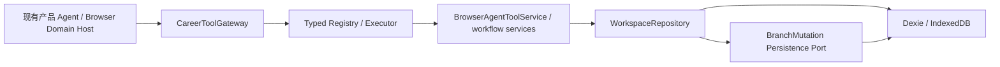
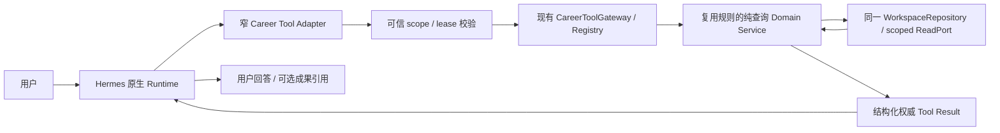

# P5.2.2-A-03 — Career Domain & CareerToolGateway Readiness

日期：2026-11-06，Asia/Shanghai。范围：准入审计与首个切片设计，**未实施业务接入**。

**总体：A-03 生产工具接入 BLOCKED；独立的 Profile 只读切片研究与后续实施准备 CONDITIONAL GO。** 现有业务能力值得复用，但当前原生 Host 的 fixture 展示不等于正式 Career Domain 接入。A-02-01 客户端 UNKNOWN 防重发不是服务端业务幂等；真实已执行后丢 ACK 的完整故障恢复资格没有关闭。可信确认、后端撤权和统一的权威操作回执同样未达到生产写入门槛。

本轮不改生产源码、Main/Preload、Hermes Core、依赖、Schema、Fact Guard、数据库；不读真实资料，不执行 Provider、Electron、MCP 实施或业务写入。不提交、不推送。唯一推荐下一路线见第 9 节；仍需用户批准实施。

## 1. 基线、资料与证据等级

- main / HEAD / fetch 后 origin/main 均为 `6545c0f04fa1b7880398b249338bd0f4673a2150`，提交标题 A-02-05，起始工作区干净。A-02-05 确已提交；旧 plan/history 的“尚未提交”已由本轮交接纠正。技术 PARTIAL 不因提交而改为 COMPLETE。
- 八个 worktree 只读登记，未进入或修改其他工作树。
- 锁定 Runtime 0.19.0 / `eb52760564dbba2e5971fa54bd67384e281cd3b8`；实际外部源码 HEAD 相同。SDK 依该锁定源码审查，不使用最新上游能力推断。Desktop package 0.17.0 与 Runtime 版本标签应区分。
- 已读 AGENTS、plan4 当前状态、history4 最近相关记录、A-02-01 完整报告及 READY 收尾、A-02-02～05 报告、现存 P5.2.0 A/B/B1/B2-A/B2-B0/B2-B1/B2-B2 报告，核对最终 manifests 和相关源实现。
- 用户所称 P5.2.0 “Hermes Vertical Distribution Feasibility & Trust Audit”精确标题报告未找到；现存 B2-B2 同样记录该缺失。已用现存架构/信任报告和锁定源码继续审计，**不冒称读过缺失报告，不据此断言产品缺陷**。
- 47 份源码/测试入口、16 份历史报告、32 份历史 manifest 的路径、SHA、行号锚点见 [源码审计](evidence/p522-a03-readiness/career-domain-source-audit.json) 与 [路线核对](evidence/p522-a03-readiness/current-roadmap-verification.json)。机器化读取/锚点扫描不等于每条业务分支均动态执行。
- 历史 manifests 中 8 个引用与当前字节不同：A01 manifest 中 5 个共享脚本/报告，A02 中 plan/history，A04 中 Renderer 集成脚本。它们是历史快照与后续共享文件的差异；本轮未恢复旧字节或修改历史证据。A05 manifest 的可校验引用全部匹配。旧 manifest 原件保持不变；不能把跨阶段文件演进称作本轮破坏。

证据分为本轮源码确认、本轮合成定向测试、引用历史真实 Host、未来验收设计。缺少动态证据标为 NOT VERIFIED，不能反推源码必有缺陷；已确认的结构性缺口明确标为 BLOCKED。

## 2. 真实业务架构与调用链

### 2.1 已存在的产品路径

Gateway 是现存统一业务工具入口，不需另建。`src/agent/tools/CareerToolGateway.ts` 负责稳定工具名、read/write 元数据、确认策略、输入/结果绑定、阶段策略、错误分类和 receipt envelope；`registry.ts` 负责严格参数 Schema、source tool 定义和分发；`BrowserAgentToolService`/专用 workflow 服务负责业务组合；Repository 才有持久化权威。

这些层并未全部独立于浏览器：`BrowserAgentToolService` 默认实例化 WorkspaceRepository；Repository 仍具体依赖 CareerAdaptDb。现有 `CareerPersistencePort` 只抽取五实体分支变更事务，不是完整 Profile/Job/Resume 查询服务。B2-A SQLite/迁移 worker 是隔离 PoC，不是已上线的独立业务数据服务。

现有 UI 也不一律经过 Domain Service：`src/app/profile/ProfileWorkspace.tsx:73` 创建 Repository，保存直接调用 `saveProfile`。这符合现有“正式写入经 Repository”，但不满足本轮目标中“UI 不绕过 Domain Service”的完整目标形态。记录差异，禁止把整个 UI 服务化扩展为本轮工作。

### 2.2 当前原生 Host 与目标切片

当前 Host Profile：原生路由 → Career Profile UI → `faithfulReadClient` → 合成 fixture。`poc/host-experience/profile-read-model.ts:11` 没有正式 Repository 接入；旧 Profile packaging/read client 也只是显示投影与合成 PoC。A-02-02 Python echo/failure 插件没有连接 Career Gateway。

目标，**尚未实现**：

Hermes 选择工具和解释结果；Adapter 只做协议转换；authority 从受信来源绑定 Profile/Person/Session 和允许范围，不能信模型参数；Gateway 执行业务工具政策；Domain 验证业务关系和最小投影；Repository 返回权威版本与内容；模型不得自行宣称数据库写入成功。Skill 是建议机制，Artifact 是文件展示，都不是职业数据权威。

本轮不选择新的数据库、不恢复 Native Runtime、不实施新的 MCP。独立服务最终生产发行、存储切换和可信确认仍沿既有架构门禁单独处理。不能通过让插件直接使用 Dexie 或把 Repository 导进 Hermes Python 来省略边界。

## 3. Career Domain 能力盘点

| 业务 | 现有正式实现 | 当前接入限制 |
|---|---|---|
| Profile | CareerProfile v2；structured facts/basics；经历/技能/证书/evidence/sourceRanges/provenance；Person/Profile 版本；导入/访谈/reconciliation；Repository 维护 | 原生 Host 仅 fixture；读取会隐式运行迁移；工具输出来源不足；写入可信确认未成立 |
| Resume | Resume Schema v2；General/job_specific Branch；Revision、CAS、编辑器；派生 ResumeDocument；presentation projector、预览和 PDF 产品路径 | 没有原生 Host 正式只读全链资格；不能把原产品能力视为 Node service 已完整提取；写入不能绕过门禁 |
| Job | 原文/来源、SourceSpan requirement/graph；草稿、解析、核对提交；RequirementMatch/Job Fit；Repository | JD analysis 可写草稿，不可冒称零写入读取；经典岗位导入无通用内容去重保证；V4 listing 能力不自动启用 |
| Tailoring | Session/QuestionPlan、唯一 activeQuestionId、答案 receipt、Diff、确认与 apply、独立岗位分支/Revision | 业务流程成熟，但不是已认证的原生工具入口；可信最终 apply 仍受统一写门禁 |

### 3.1 Profile 的关键根因

`CareerProfileSchema` 在 `src/domain/schemas/profile.ts`；`version` 是写版本，`profileVersionNumber` 是同 Person 的资料版本，两者不能互换。fact/evidence/provenance 均有正式结构；source path 只是引用，不能证明文件仍存在，也不能当作读取任意文件的授权。

已有 `career.profile.get/search_facts/list/active`。`BrowserAgentToolService.getProfile:1251` 经 Repository 查询，用 canonical library 构造返回；最多 60 条，每条正文 800 字符。只返回 factIds，并未展开完整来源与确认状态。`searchProfileFacts` 是词项命中排序，不能替代“列出全部项目/技能”。新切片要扩展现有工具投影/分页，不另造 Profile JSON。

**纯只读阻塞：** `WorkspaceRepository.getProfile:2641` 和 listProfiles 调用 `ensureCareerIdentityMigration:1171`。该方法开启 rw 事务，写 person appMeta/current index 和时间；旧资料还可规范化写入 profiles。因此即使查询名称是 read，也不能保证零业务写入，且可能扫描/规范化其他 Profile。源码足以确认副作用，本轮没有打开真实库验证或触发它。

最小方案是同 Repository 内分离显式初始化/兼容迁移与纯 scoped query：工具调用不能自动迁移，未初始化返回明确错误；初始化由产品 authority 独立控制。不要通过 clone 一份用户库、绕开 Repository 或修改已有数据语义解决。

### 3.2 Resume 隔离、CAS 和派生内容

`branch.ts` 有 profileId、branchPurpose、可选 jobId/target snapshot 和 source version；verified 岗位分支须保留岗位或快照 provenance。通用/岗位是独立分支，不是对通用简历进行原地岗位覆盖。Repository 分支 mutation UoW 中检查 expectedRevision，原子保存 Branch/Revision/operation，旧 revision 写请求会冲突；restore/undo 产生新版本。该保证只限相关路径，不能外推所有 put 都有 CAS。

`ResumeDocument` 定义/映射位于 `src/domain/resumeDocument/mapper.ts`，presentation projector 负责呈现。数据库没有以 ResumeDocument 作为新权威表；本轮不改动正文模型。预览/PDF 实现存在，但本轮未重做内容守恒或打印视觉验收，状态为已有实现/本轮输出一致性 NOT VERIFIED。

AI 通过工具/服务提出或应用受约束内容，不能自行访问 IndexedDB；可信 Host 接入仍不允许拿普通 confirmed=true 当作用户同意。现有显式同步 Profile 路径必须单独确认，不能把简历修改反向自动入库。

### 3.3 Job 身份与失效

JD 作为 JobDescription 原文/要求来源，RequirementMatch 用 profileId/jobId 分开关联。岗位要求不是用户事实，匹配证据引用 Profile，不能把 JD 技能写进个人技能库。已有 stale/source-version/hash 检查；不能因这些检查存在就声称所有岗位更新路径会自动清理所有分析缓存。

`saveJobDescription:2758` 是按 ID 验证后 put；`commitJobDraft` 是 commitId 幂等 + draft revision CAS 的正式事务。相同 commit 重试可复用，但换 draft/commitId 重复导入同一 JD 不等于全局去重。另有 V4 listing/snapshot hash/duplicate-decision 实现，属于独立对象和路线，不证明经典 JD 路径同样去重，也不在本轮启用。JD 更新后的旧分析、同岗位身份归一化仍需未来定向验收。

### 3.4 Tailoring 现有流程应复用

`tailoringService.ts` 有 activeQuestionId、回答收据和 QuestionPlan 局部推进；`buildTailoringQuestionPlan:1102` 的默认预算实际为 steady=0、competitive=1、其他=3，硬上限 5（max_fit 上限 3）。因此“一次一个、最多五个”有结构支持，但“通常 2–3 个”并非所有模式的默认行为，属于需求与现状差异 R12，不能写成完全满足。后续需用户明确是否保留按模式预算，本轮不改变产品语义。回答更新计划，不在每个回答步骤无条件重新跑全部分析。summary/skills 优化与 project/work/internship 的来源约束和 Diff/claim policy 已有实现；最终 apply 走专用 commands/Repository。

已有实现支持“一次一个问题、有限问题、最终统一审阅”方向。本轮相关 commands/Repository 测试通过，但没有完整执行全部产品交互用例，因此不宣称所有模式下的提问数量、每个 Diff 和事实保真均已重新验收。将来接入调用这些流程，禁止再造访谈或绕过统一确认直接修改项目/实习经历。

## 4. Gateway 能力与安全差距

已有 Tool Registry、typed contract、Profile/Resume/Job/Tailoring/Import/Export 工具和 facade、confirmation metadata、Tool Result/receipt、error mapping、operationId 和部分 Repository 幂等。**这些字段存在不等于安全准入已完成。**

- `verifyExecutionBinding:553` 取决于 context；未要求绑定或未注入 verifier 时允许继续。新入口必须由可信 composition root 强制 scope，不得让模型关闭校验。结果的 Profile 校验有价值，但不是调用方身份认证。
- `confirmed/confirmationCount` 是调用上下文数据，普通 Renderer 可构造。它们可以保留为内部接口，不能对外充当可信凭证。
- Gateway receipt 的 idempotencyKey 等于 operationId，只是元数据，不是提交一次的数据库证明。
- `repositories.ts:7764` 的 operationId lookup 在 CAS 前重放，未绑定完整 scope/method/payload；还可能返回当前 Branch 搭配旧操作 Revision。需要权威历史结果引用，不能用当前状态冒充原始回执。
- Branch mutation 的事务、CAS 和 operation 是现有基础；Profile、Job、workflow 的所有写入并没有统一的一套生产幂等协议。不能建立一个空壳新 Gateway 掩盖这些差异。

## 5. A-02-01 请求可靠性门禁

当前 `p522-host-a01-renderer.mjs:82` 在显式 `--reliability` 时应用 A01 patch；A04 `--session-persistence` 再叠加 journal 恢复。A05 的集成构建也包含这条组合路径。它们处于有效 opt-in 开发集成链，不是默认生产修复。optIn=false 不启用 Career 变换。

| 场景 | 已有证据 | 尚不能声称 |
|---|---|---|
| prompt.submit 重连/ACK 丢失/超时 | 锁定函数 patch；历史 L2 真 WebSocket + 确定性 effects，已从重复执行降为 UNKNOWN 不重发 | 服务端业务 exactly-once |
| delta 后连接中断/504 | L2 不重发；历史 Provider 504 不自动 fallback | 实际 Tool 写完再断连的完整对账恢复 |
| UNKNOWN 持久化/恢复 | A04 原生日志，真实受控转发前故障 + reload/Electron 重启恢复 | 实际服务端已执行丢 ACK 后重启同样已验收 |
| 清除横幅后 guard | 最后 patch 的 L2/build/Native TS | 最后 patch 已有 Electron 退出码 |
| 跨 Session | A04 两 Session 隔离，新任务单次发射 | 全部跨 Session 工具队列故障矩阵 |

原生 journal 限 24 项/7 天，不是永久业务 receipt。缺失 journal 不表示操作未执行。A02-02 真实原生 dispatcher/handler/tool_call_id/第二次请求 tool role 有 L3 证据；成功 echo 最终回答遇 504，Composer 工具六环节、Tool UI/Stop/历史不重执仍未齐。A05 write_file 成果成功不能替代 Career Tool 生命周期资格。

因此 H = BLOCKED；生产工具接入必须 BLOCKED。后续只读设计可独立推进，但生产开启必须先在实际启用路径闭合有限、定向的原生工具与 UNKNOWN 门禁，不再泛化 Host 重构。不允许已接受/未知 write 换备用模型或新 operationId 重做。

## 6. 可信确认与撤权

所需链：Proposal → Exact Diff → server Proposal Hash → 独立用户确认 → 原子消费 → Repository write/CAS → durable authoritative receipt。

现有 pending proposal 可持久化和重复读取；`consumePendingConfirmation:8429` 只在 appMeta 事务中消费，不能自动与后续 Profile 写形成一个事务。另有绑定 hash/revision 的 conversion confirmation，不等于原生 Host 的独立可信 issuer。

| 必需属性 | 本轮结论 |
|---|---|
| Profile/Person/Session/operationId/精确 hash/版本绑定 | 业务部分字段存在；完整可信链 BLOCKED |
| Diff 修改后重新确认、过期/取消后无效 | 新可信协议尚无正向资格，NOT VERIFIED |
| 单次消费与正式写入原子性 | 现有单独 consume 不满足统一 apply；BLOCKED |
| Renderer 不可伪造同意 | 锁定 public SDK 无已证明的独立 issuer；BLOCKED |
| 刷新后有效性/旧 receipt 复用拒绝 | 必须由服务持有状态而非 UI，未闭合；NOT VERIFIED |
| 插件 disable 撤销旧 closure | 后端未验证租约/epoch，旧 ctx.rest 仍可用的历史真实 Host 证据成立；BLOCKED |

实际锁定 `runtime-loader.ts:17` 明确 FULL app authority；PluginContext 暴露 rest/socket/storage/contributions，SDK host 有 gateway RPC 等。manifest capability、pluginId、认证 HTTP token 和漂亮确认弹窗都不是沙箱或人类同意证明。Python plugin 也是受信代码，不是隔离租户。

本轮源码复核未发现后续已补足的 Career 可信 issuer/每请求 revocation。贡献 disposer 删除导航和 UI，`plugin.ts:111` 的 rest closure 本身不带撤权条件。后端必须独立校验有效 grant、scope、Session 和 epoch/expiry；客户端传入 Profile ID 不能当身份。若解决可信表面需要 Main/Core 改动，必须另行架构批准，本轮不改。

## 7. 首个垂直切片的具体设计

选择 **A：Career Profile Read-only**。已有 get/search/canonical projection 继续复用；新增量限于纯查询 Port/service、可信 scope/revocation adapter、分页和来源投影。它不是现在就可上线的完整链。

用户“看看资料库有哪些项目经历和技能” → Hermes 选择现有 profile get（拟扩展 section filter/paging） → adapter 注入可信上下文 → Gateway strict Schema/allowlist → scoped query → 同一 Repository 纯读取 → structured result → Hermes 基于真实结果回答。

拟定请求参数只有 sectionTypes/limit/cursor 等业务筛选；Profile/Person/Session 来自 authority 绑定，不信 Agent 请求。业务 Schema v2 不变。返回 profileId、personId、sourceRevision、canonical item IDs/section/text/factIds/confirmationState、最小 evidence/provenance opaque refs、nextCursor/truncated/requestId；无需读取源文件字节或默认暴露联系方式/本机路径。

空资料返回明确 empty，未知 ID 返回 NOT_FOUND，撤权 FORBIDDEN/SCOPE_REVOKED，legacy 未初始化返回 INITIALIZATION_REQUIRED，服务错误保持 error。不得自动返回 demo/另一个 Profile，不得把检索无命中解释为“资料库无经历”。确认状态作为来源事实传递；AI 推断不能标成 confirmed。

查询前后所有 stores 内容/时间/计数相同，含 appMeta；这比“没有新增 Profile”更严格。初始化不隐藏在工具调用里。读取失败时 Assistant 不得说“已读取成功”；权威 Tool Result 而非自然语言是成功依据。

尚无 Profile 查询生产服务，不能直接把 fake_service 更名上线。若 Port 提取超出最小范围，应保留 BLOCKED 并交用户审阅，不能顺带迁移整库。

## 8. 验收设计与本轮实际验证

未来切片至少验收下列 20 项；**设计用例均未在本轮声称执行**，详见 [test-plan.json](evidence/p522-a03-readiness/test-plan.json)。

1. 当前 Profile 权威读取；2. 经历完整分页；3. Skills 完整读取；4. empty；5. missing；6. 两 Profile 隔离；7. strict 参数/注入/大小校验；8. Agent/plugin 无 Dexie 依赖；9. provenance/confirmationState 保真；10. 零业务写入含 legacy；11. 失败不伪装成功；12. 刷新历史不执行 handler；13. 原生 Session 不变；14. Streaming/tool_call_id 顺序；15. Stop/晚结果；16. optIn=false 无功能；17. 捕获 closure 在 disable 后拒绝；18. 实际服务端接受/执行后丢 ACK 不重发；19. >60 条/800 字符截断明确；20. JD/来源注入不能越权或造个人事实。

全部使用隔离、合成的 Person/Profile A/B、空/不存在/legacy/大资料 fixture，不读真实 Career/Hermes home。真实 Host 用例必须观察原生组件、事件和 handler ledger；不能靠写 Store 伪造通过。Native Session/Streaming/Stop 各有独立退出码，不用 fixture Unit 替代。

本轮实际执行：

| 命令范围 | 结果 |
|---|---|
| vitest：agentProfileTools、p520b1-persistence-port、repositoryTailoringV2、p522-slice1-profile-projection | 4 文件 21 测试，退出 0 |
| vitest：jobWorkflow、p45c1c15-career-context-binding、tailoringCommands、resumeV2Schema | 4 文件 26 测试，退出 0 |
| Git fetch / HEAD / worktrees、源码/历史 SHA、JSON/链接/保护与 diff | 机器结果与最终 manifest 记录 |

这些定向测试覆盖现有合成产品行为，不证明未来查询服务/可信确认/native tool 链已通过。不重复历史 Provider/Electron/故障全谱，不运行无必要 build/typecheck/full lint/Release Gate。纯文档与审计辅助脚本没有改变生产编译输入。

## 9. 唯一推荐路线与生产写入最小解除方案

顺序 **A Profile read → D Resume read/analysis → B Job read/独立 JD analysis → C confirmed Profile reconciliation → Tailoring final apply**。Job 和 Resume 的只读不依赖可信写入 issuer，但都依赖已合格的纯查询 authority；JD analysis 若保存草稿则是写操作，不能偷渡到 read 权限。

1. 用户批准后，先在合成数据中提取同 Repository 的纯 scoped read/service；分开初始化，保留 canonical Schema/规则。完成零写入与 scope/provenance 用例。
2. 接现有 Gateway 的窄 read adapter；后端逐请求绑定身份和撤权 lease/epoch，拒绝旧 closure/Session。不得因为 SDK 高权限省略服务权限。
3. 在实际启用组合中完成 A01 executed-server ACK/UNKNOWN 与 A02 native 工具成功/Stop/历史资格；不发新模型探针，不重做全部 Host。未取得证据，生产读取也不开放。
4. 单独评审有限 Profile 只读上线，再复用此边界做 Resume read/analysis、Job read；不生成简历、不自动投递。
5. 生产写入另行批准可信 issuer 路线：服务持有精确 proposal/hash/scope/session/op/base revision；内容改动重新确认；cancel/expiry/epoch 失效。若现有 SDK 无可信表面，保持 BLOCKED，不做伪签名 PoC 替代人类确认。
6. 同一 WorkspaceRepository UoW 内先查 scope+method+target+payload hash 的 durable operation receipt，同 ID 同内容重放原结果，同 ID 异内容拒绝；再验证单次确认、CAS/来源版本，原子消费确认+mutation+receipt。新增元数据/Port 必须沿既有存储边界设计，不默认增加表或迁移全库。
7. operation.getStatus 作为窄权威查询，按 committed/notStarted/unknown 区分；响应丢失只查询/同 ID 重放，不换模型重新写。故障点覆盖消费前、消费后写失败、commit 后丢响应、重启、冲突和撤权，检查全回滚或唯一历史 Revision。
8. 只在以上成功后开放 confirmed Profile reconciliation，再接现有 Tailoring 最终 Diff/apply。服务 runtime 发行、备份/迁移/安装包资格仍独立审批，不从 PoC 成功自动推出可分发。

依赖 DAG 与每步所需前置见 [dependency-matrix.json](evidence/p522-a03-readiness/dependency-matrix.json)。本轮所有步骤均为设计，未自动实施。

## 10. 最终 A–K 决策

| 项 | 状态 | 决策 |
|---|---|---|
| A Domain 架构足够清晰 | GO | 权威模型、Repository 与现有流程可定位；独立服务未交付 |
| B Gateway 统一入口 | CONDITIONAL GO | 复用原实现；强化可信 composition root 和边界，不另建 |
| C Profile read 开始实施 | CONDITIONAL GO | 可批准合成切片；生产接入仍 BLOCKED，先解决纯读取/授权与 native 资格 |
| D Profile 生产写入 | BLOCKED | trusted issuer、撤权、原子确认/receipt 与 UNKNOWN 均未齐 |
| E Resume Tools 开始实施 | CONDITIONAL GO | 只读/分析在 Profile 边界合格后；修改/生成/export 新接入另审 |
| F Job Tools 开始实施 | CONDITIONAL GO | 先 read；持久化 JD analysis、重复导入和更新需独立门禁 |
| G Tailoring Tools | BLOCKED | 复用已有流程，最终 apply 受写门禁，当前不开放 |
| H A01 未知执行风险充分控制 | BLOCKED | 有效 opt-in 抑制/恢复，但缺真实已执行故障资格与业务幂等 |
| I Trusted Confirmation 达生产 | BLOCKED | 普通 Renderer 确认非可信 issuer，未原子消费+写入 |
| J 首个功能 | CONDITIONAL GO | 唯一选择 Profile Read-only Vertical Slice，先合成、后有限生产 |
| K 到真实产品剩余步骤 | CONDITIONAL GO | 按第 9 节逐门实施；只读→分析→可信写入→现有工作流→输出与发行验收 |

问题严重性与修复定位见 [failure-record.json](evidence/p522-a03-readiness/failure-record.json)：R02 CRITICAL；R01/R03/R04/R05/R06/R09 HIGH；R07/R08/R10/R11/R12 MEDIUM。缺历史报告和缺测试证据未伪装为已证实产品 bug。

本轮审计/设计交付完成，不表示 A03 生产准入通过。执行记录、最终保护、manifest 一并交付；plan4/history4 更新，尚未提交。到此停止，等待用户审阅与批准具体实施。
