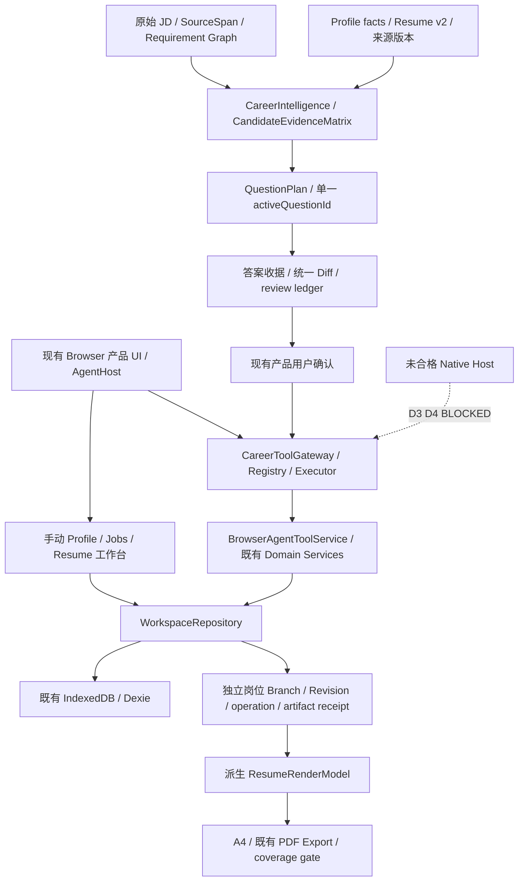

# P5.2.2-B01 — Core Career Workflow Audit / B01.1

2026-11-07，Asia/Shanghai。**PARTIAL / NOT COMPLETE**。本轮完成业务源码盘点和 confirmed apply 的两项 P1 修复；未完成要求的整条 Golden Journey，不将 Unit 通过写成端到端通过。无提交、推送、Native 权限扩大、数据库新增表、生产依赖、事实阈值或 Hermes Core 改动。

## 1. 基线与交付索引

Starting HEAD / fetch 后 origin/main：`3bd558bb72e43ef4f3fcd5429d63ce3f1796839f`，main，tracked/untracked 起始干净，八个 worktree 保留。A05R 已包含在远程；旧报告中“尚未提交”属于历史时间点，不改写历史文件。A05R 仍为 PARTIAL / NOT QUALIFIED，G1 FAIL，G2–G6 NOT VERIFIED。D3 暂停，D4 未进入。

已读取 AGENTS、plan4/history4 当前交接、A03/A04/A05/A05R 报告、ADR A05-01、A05 的 28 项清单及 A05R delivery manifest。实际 evidence 位于 `docs/architecture/evidence/`；用户附件中的短路径按这一真实位置解析。当前 plan4 中未检索到名为 Golden Journey 的 J1–J6 定义，故以下以本轮附件的 J1–J6 为验收索引，不伪称存在旧定义。

- [28 项逐项映射](evidence/p522-b01/capability-map.md) / [机器清单](evidence/p522-b01/business-capability-inventory.json)
- [基线](evidence/p522-b01/baseline.json)
- [Golden Journey 矩阵](p5.2.2-b01-golden-journey.md)
- [实现与数据完整性](p5.2.2-b01-implementation-integrity.md)
- [简历质量与第三方研究](p5.2.2-b01-quality-references.md)
- [本轮验收汇总](evidence/p522-b01/test-results.json) / [最终定向 Unit 原始报告](evidence/p522-b01/unit-results-final.json)

## 2. 实际架构与 A–G 业务链

图中手动工作台直接调用 Repository 是现状，不冒称所有 UI 都经过 Gateway。本轮仅修复现有 Agent service/Repository apply，不新建或绕开工具入口，也不将手动工作台全面服务化。

| 链 | 实际实现、状态变化与持久化 | 本轮证据与限制 |
|---|---|---|
| A Profile | 导入/来源轮次→规范化候选→核对/reconciliation→确认→CareerProfile；正式写入由 Repository 承担 | guided intake Repository、reconciliation、import review 定向测试；未完成真实文件导入至 Profile 的浏览器完整验收 |
| B General Resume | Profile/canonical item选择→既有 composition/compile→Resume Schema v2→general Branch/Revision | composition Gateway 定向测试；Route B 浏览器真实从资料库创建通用简历；未将一次按钮操作等同完整编译质量认证 |
| C Job | rawText→parse/semantic graph→Requirement/SourceSpan/关系组→核对→正式Job；Agent commit 使用现有候选岗位管道与绑定确认 | JobWorkflow/semantic compiler 测试；本轮未新增 parser，不将岗位技能写进 Profile；JD更新所有缓存失效仍未全路径验收 |
| D Fit | Profile/Resume+Job→CareerIntelligence→CandidateEvidenceMatrix→优势/缺口/解释/问题 | core02 测试确认未知与不匹配区分、JD不成为用户能力；矩阵绑定Profile/Resume/Job版本及graph hash |
| E Tailoring | Session→冻结QuestionPlan→逐题回答/receipt→答案revision hash→统一Diff→accept/edit/reject→确认→原子derive/apply | 单元/Repository/恢复链已测；完整 Browser 问答至Diff生成未通过，不能宣告主链闭合 |
| F Export | 持久化Revision→派生RenderModel→presentation/pagination→HTML/PDF与coverage检查 | 本轮覆盖snapshot round-trip、结构化字段及HTML语义；没有本轮真实下载PDF与文本层守恒证据 |
| G Persistence | Person/Profile身份、Profile version、General/Job Branch、Revision独立；TaskState/session保存问题/答案/进度；appMeta保存checkpoint/receipt | durable artifact恢复测试与Route A reload通过；并非所有中断点的浏览器reload认证 |

## 3. 业务审计问题

| ID | 位置 / 根因 | 影响 / 优先级 | 实测、修复与后续 |
|---|---|---|---|
| B01-P1-01 | 两条Tailoring Repository写入仅按operationId返回旧结果，未绑定输入 | 同ID换岗位、来源版本或Diff会误报旧成功；P1 | 新增真实Repository红测复现；操作记录增加可选请求指纹，原子写入并核对，不符拒绝。通用派生与岗位新Revision均覆盖 |
| B01-P1-02 | Service重复apply重新生成completedAt，违反不可变artifact receipt契约 | 首次写入成功后重试报错，妨碍安全恢复；P1 | 新增真实Service+Repository红测复现；通过请求绑定与回读后保留首次完成时间；新Service实例重试与回读失败恢复通过 |
| B01-P1-03 | derive回放before hash取当前source branch而非源Revision | 来源编辑后回执前态可能漂移；P1风险，源码确认 | 同一修复内改读previousRevision不可变snapshot；初次/retry hash一致断言通过；未做任意历史损坏修复 |
| B01-E2E-01 | 旧Tailoring测试调用契约/选择器落后，且当前模型阶段未闭合 | 用户核心生成链仍无本轮端到端证据；P1验收阻断，底层根因未确证 | 原测试四次执行记录保留；修正mode select与batch任务名，限定可选evidence provider失败；最后两次在建议卡片等待60秒超时，停止重跑。最新页面仍生成中，不能归因成已证实Provider故障 |
| B01-E2E-02 | Job A/B旧测试在创建后导航期间直接page.evaluate | 测试读取context销毁，非数据丢失证明；P2测试问题 | 原失败保留，未扩大为UI或Repository修复；单独Route A/B已通过 |
| B01-GAP-01 | Route推荐只使用item/evidence/resume计数 | 未全面比较成熟度、岗位相关度、provenance及recency；功能部分实现 | 保留确定性用户可切换机制，不让LLM编造规则；作为后续业务目标，不顺手重写 |
| B01-GAP-02 | 28能力源码存在，但J1–J6尚无一条本轮完整Browser验收 | 无法把注册/Unit/历史结果推成普通用户成功率 | 明确剩余验收矩阵；不得宣告B01.1 COMPLETE |

没有在本轮合成测试中确认 Profile 被 JD 污染、通用简历被岗位修改覆盖或 Revision 丢失；这不等于对全部入口的无缺陷认证。重复导入、跨全部入口的缓存失效、所有stale checkpoint/答案修改/拒绝Diff/任务完成重执行仍按矩阵区分定向Unit与未验Browser。

## 4. 下一步与停止点

本轮只完成 confirmed apply 可靠性这一关联修复范围，没有重做 Job/Fit/访谈/质量系统。**最值得投入的一个下一目标：用当前 Browser Agent Gateway 路径和确定性模型驱动，关闭“单题回答→统一Diff→真实用户确认→独立Revision→实际PDF下载”的一条Golden Journey，并记录每个模型任务的请求、响应与有界失败状态。** 先定位当前生成停留点，禁止再次盲目延长等待或用假Tool成功绕过Repository。

普通 Browser 产品路径继续复用现有能力；其成功不依赖恢复D3验收。Native插件接真实Profile、生产可信issuer/授权/写入仍依赖D3/D4，保持关闭。当前停止，不进入B01.2、D4或A05R G1，不自动提交推送。

## 5. 最终工程验收

最终18个定向测试文件140/140通过，0 skipped；包含真实Repository事务、Service恢复及并发重复apply。最终pnpm typecheck、6文件changed ESLint --max-warnings=0、pnpm build、git diff --check均退出0。构建生成的next-env路由引用已精确恢复为本轮基线，不纳入交付。未运行全历史Unit/全量lint/全量Playwright/Release Gate；以上不构成全量回归通过。

Browser单独Route A/B各1项PASS；其他用例失败详见矩阵。未完成Golden Journey和真实PDF/Provider认证。原失败与r3测试驱动错误均保留。所有修改尚未提交，未推送、未打包；本轮工作到此停止。
