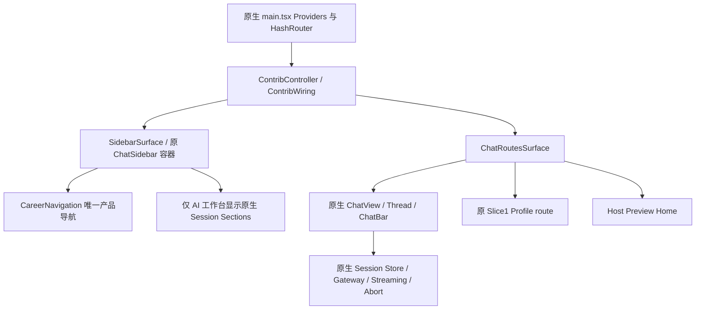

# P5.2.2-HOST-A-01：Hermes 原生 Host Shell 集成

2026-11-04（Asia/Shanghai）。**整体 PARTIAL；隔离 CareerAdapt Shell 定向 Host 验证 PASS；生产迁移与最终产品视觉验收未完成。** 本轮 main 明确采用方案 A：保留 Hermes Electron/Renderer/Conversation Workspace/Runtime，改造 Renderer 最外层 Shell。SHELL-01 的方案 C 推荐不再作为执行方向，competition/5.1.8 未切换、修改、合并或 cherry-pick。

## 实际交付

在锁定 Hermes `eb52760564dbba2e5971fa54bd67384e281cd3b8`、Desktop 0.17.0、Runtime 0.19.0 上，建立 `node scripts/p522-host-a01-renderer.mjs --careeradapt` 的独立开发入口。它在构建/开发加载时执行四个 Renderer 源文件的精确锚点补丁，原上游磁盘文件不写入；不带开关时不应用 Shell 补丁。不是 iframe、DOM 隐藏或新写的聊天应用。

唯一产品主导航包含首页、AI 工作台、个人资料库、设置；高级原生功能在可展开菜单中映射。Sidebar 原应用菜单组从 React 组合层被替换，原会话段落和状态逻辑在 AI 工作台内部保留。原生 `onNavigate` 分派页面路由及 `new-session`，保留原来重置 `$newChatProfile` 的行为。Profile 内的19类仍为页内分类，不出现第三套全高菜单。

首页为明确标记的 Host Integration Preview 入口，**原 `HomeWorkspace` 的业务数据和统计尚未迁移**。Profile 直接加载已有 Slice1 单 ESM，`poc/host-experience/`、`poc/profile-plugin/` 均未修改；只读合成 DTO、来源说明和原 Product 控件保持。其他业务页没有空白占位实现。

Shell palette 仅以原生 ThemeProvider 的 `data-hermes-mode` 为权威，在 `.ca-host-shell` 下适配品牌绿与浅灰绿/深色画布；没有第二个全局主题 store/setter。原生 Chat 的 Hermes 标题、蓝色背景和部分 native chrome 仍在，故不宣称最终品牌视觉已完全统一。

## Git / Undo / 历史保护

开始 main/HEAD/origin/main 均为 `67505b957d486b7ea082f4cf82ce87ad44feee9b`，起始工作区干净，fetch 退出0。执行了分支、status（含 ignored）、worktrees、15条 log、diff/cached/diff-check/fetch核对。SHELL-01 两份报告和证据目录已不存在，Git无对应跟踪路径或提交；无法从Git直接证明 Codex Undo 点击动作。被忽略的 plan4/history4 仍有其历史条目，予以保留，并置顶本轮方案A决定，没有破坏性撤回。

四份历史 manifest 共314项校验，5项旧P522记录对应的 Host view/CSS/build/test/README 被后续已提交 Slice1 修改，当前 Slice1 manifest 对应文件匹配。差异记录而未恢复旧文件。上游 Desktop 源码起始/最终无 Git diff，外部整树既有其他修改保留。没有删除文件、提交、推送、切分支、安装依赖、打包、访问真实职业资料或真实模型凭据。

机器依据：[baseline](evidence/p522-host-a01/baseline.json)、[Undo状态](evidence/p522-host-a01/undo-state-audit.json)、[历史SHA](evidence/p522-host-a01/historical-manifest-verification.json)、[上游最终状态](evidence/p522-host-a01/upstream-final-verification.json)。

## Shell 与原生 Workspace 边界

`ChatSidebar` 含 profile/project/session atoms、列表搜索和动作，因此只替换应用导航组合，不删除整个组件。`ContribWiring` 的 Gateway启动、session cache、composer actions、model/stream hooks、native overlays均保留。Root 的 QueryClient/I18n/Theme/Haptics/HashRouter 与错误边界不变。Home必须加入路由分类，否则会被 `/:sessionId` 当作会话；Profile继续走原贡献注册路由。

四个虚拟上游修改文件：

| 文件（相对 Hermes root） | 修改 |
|---|---|
| `apps/desktop/src/app/chat/sidebar/index.tsx` | 替换原顶层菜单 JSX，调用 CareerNavigation；原Session段落只在Chat视图展示 |
| `apps/desktop/src/app/contrib/surfaces.tsx` | 增加 Preview Home route；原 `chatView` 与所有原路由继续存在 |
| `apps/desktop/src/app/routes.ts` | 保留 Home path，分类为 extension，避免 session-id 误解析 |
| `apps/desktop/src/app/contrib/controller.tsx` | 外壳根增加 palette scope class |

需要维护有版本绑定的 Renderer integration patch。当前以 [runner](../../scripts/p522-host-a01-renderer.mjs)、[patch manifest](evidence/p522-host-a01/patch-manifest.json) 和 `patched/**/*.txt` 保存完整可复查结果；精确锚点不匹配时失败，不猜测新版路径。源文件快照附带 [上游MIT许可](evidence/p522-host-a01/HERMES-LICENSE.txt)。未提取Conversation组件库，未拆Runtime Sidecar，未修改Main/Preload/Agent执行/Tool Dispatcher/Gateway协议。

## 验证与限制

最终有界诊断 [navigation-diagnostic.json](evidence/p522-host-a01/navigation-diagnostic.json) 退出0：真实Electron+Renderer，Home/Profile/Chat × 1920×1080、1440×900、1024×768 × System dark/light，共18格；唯一主导航、无文档横向溢出、原生设置/Appearance/System、原生附件菜单、未发送草稿跨Profile往返、新建草稿原语义通过。字体 codicon/Collapse加载正常。代表截图已实际查看，非独立浏览器原型。

较早完整smoke对19类、条目/详情、搜索/归档筛选、刷新与六格通过，但该runner随后存在主题焦点/设置/状态文字定位失败。`Gateway` 与 `ready` 是两个span，视觉与可访问名称聚合而 `getByText`不匹配；连续两次45秒超时后停止完整smoke，不称该runner最终通过。后续只做源码驱动、10秒上限的独立导航诊断，原失败日志/截图全部保留。

默认Shell第一次只检查元素存在，实际截图仍有onboarding，**撤回其交互PASS解释**。强化点击测试先遭原生遮罩/控件重建，后因原生菜单名称包含快捷键而exact-name超时；两次失败后停止。默认Shell原生菜单、Chat和ready状态已在失败截图中显示，未出现Career产品导航；**默认Shell完整交互回退仍 NOT VERIFIED**。runner选择器已修正但未再次运行，不能把修正当通过。没有同进程Shell热切换资格，也没有完整Runtime发行资格。

证据限制：早期fallback runner使用固定失败截图名，第二次强化失败覆盖了第一次强化失败截图；两次原始失败日志、最初onboarding截图和最终默认Shell截图仍在。已改为按run保存后续截图/JSON，未再运行。原有P521/P522/Gate00/Slice1历史证据未被覆盖。

构建首次遇CRLF锚点、第二次跨目录router模块解析问题；后续改为原生动作callback，根除本地router依赖。项目typecheck曾误读证据中的`.tsx`源码副本，已逐文件改为`.txt`；未放宽tsconfig。原生虚拟编译曾报告`.tsx`显式导入扩展名问题，改为扩展名省略后上游基线/补丁后均0诊断。ESLint unused import已移除。原生新建草稿测试原先错误要求清空未发送文本，依据上游“Never clear composer here”改为强断言保持原线程草稿，未改生产行为。

字体故障由隔离开发服务器对两个已知 `/@fs/...` 字体URL返回HTML引起；开发middleware仅提供这两个锁定包字体文件，未开放任意文件读取，未改上游CSS或字体。它不进入生产build。早期方框图标截图保留，最终截图字体正常。

| 检查 | 结果 |
|---|---|
| 基线 project typecheck + 2文件10Unit | PASS |
| 最终 project typecheck / changed-files ESLint | PASS（具体命令/退出码见test-results） |
| 项目定向Unit | 3文件14项PASS |
| 原生Hermes route/stream-flush/prompt-actions | 3文件98项PASS；确定性测试，非真实Provider |
| 原生TypeScript虚拟编译 | 基线0、集成0、新增0诊断 |
| Host Renderer integration build | PASS；非Next生产构建/安装包 |
| 最终有界真实Host诊断与18格 | PASS，pageerror/consoleErrors=0 |
| 原始完整smoke / 默认Shell强化交互检查 | FAIL保留；后者NOT VERIFIED |
| 真实模型stream/tool/stop、真实附件传输、持久历史 | NOT VERIFIED |

Next生产边界未改，不运行Next生产build、PDF、安装包、全量Playwright/四分片或C1/C2。所有正式业务写入边界、Resume Schema v2、Fact Guard、Repository、模板及数据表不变。

## 用户要求的二十项回答

| # | 问题 | 状态与结论 |
|---|---|---|
| 1 | 是否实现CareerAdapt外壳 | **PARTIAL**：真实Electron opt-in外壳已实现；非生产发行与最终全品牌验收 |
| 2 | 是否一套产品主导航 | **PASS**：最终18格均唯一；AI会话为内部上下文 |
| 3 | 是否复用原生Conversation Workspace | **PASS**：直接ChatRoutesSurface→ChatView，无新聊天框 |
| 4 | 原Store/Context是否保留 | **PASS**：源码/哈希/虚拟类型检查与跨页草稿验证 |
| 5 | Streaming事件链 | **PASS**：实现不变、确定性回归通过；真实Provider **NOT VERIFIED** |
| 6 | Stop/Abort原实现 | **PASS**：cancelRun→session.interrupt不变；实际活动Run停止 **NOT VERIFIED** |
| 7 | Tool Activity原组件 | **PASS**：原结构化tool renderer保留；真实调用 **NOT VERIFIED** |
| 8 | 附件原实现 | **PARTIAL**：原菜单与链保留；未选文件、未上传 |
| 9 | Session/历史 | **PARTIAL**：空历史、原生动作/草稿往返通过；已填历史及重启恢复未测 |
| 10 | Profile复用Slice1 | **PASS**：原View/DTO/Plugin未改，只读合成 |
| 11 | 原Product组件 | **PASS**：原业务页面/控件保留，Profile继续复用 |
| 12 | 重复Shell/导航 | **PASS**：组件组合替换，无CSS隐藏、iframe或DOM移除 |
| 13 | 哪些上游文件变化 | **PASS**：四文件虚拟补丁清单；上游磁盘无改动 |
| 14 | 是否维护Fork/Patch | **PASS**：需要维护锁定Renderer补丁；无需Conversation库Fork/Runtime拆分 |
| 15 | Main/Preload修改 | **NOT IN SCOPE**：未修改且本切片未发现必要性 |
| 16 | CareerToolGateway能力 | **PARTIAL**：已审计真实读工具/工作流；未连接此隔离Host |
| 17 | 真实Tool Calling验证 | **NOT VERIFIED**：没有真实模型或伪造业务调用 |
| 18 | 未验证能力 | **NOT VERIFIED**：默认Shell交互、真实stream/stop/tools、附件全链、持久历史、Artifact任务绑定及发行安全 |
| 19 | 升级风险 | **PARTIAL**：有4处锁定补丁/样式/route耦合；升级需逐处审计与重验 |
| 20 | 下一步逐页恢复 | **PASS（计划）**：A02→A08依赖路线已写；未执行 |

原Renderer撤权、Trusted Confirmation、Domain Host/Runtime发行阻塞仍然存在；本轮不解除。所有未知执行结果不得自动重发，Runtime approval/confirmed=true不代替可信事实授权。

## 交付索引

- [完整导航与原页面矩阵](p5.2.2-host-a01-navigation-reconciliation.md)
- [原生交互/工具/附件链审计](p5.2.2-host-a01-hermes-interaction-reuse.md)
- [后续路线](p5.2.2-host-a01-next-stage-plan.md)
- [开发入口说明](../../poc/host-a01/README.md)
- [41份上游源码索引](evidence/p522-host-a01/hermes-source-map.json)、[Career源码哈希](evidence/p522-host-a01/career-source-audit.json)
- [Host结果](evidence/p522-host-a01/host-verification.json)、[视觉结果](evidence/p522-host-a01/visual-verification.json)、[测试与失败](evidence/p522-host-a01/test-results.json)、[交付SHA](evidence/p522-host-a01/delivery-manifest.json)

尚未提交/推送。停止于A-01交付与用户评审，不自动进入A-02。
