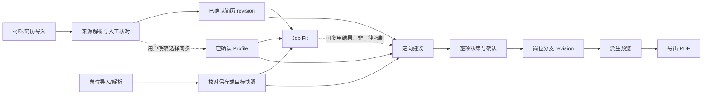

# P5.2.3.0 基线与架构审计

审计日期：2026-11-21。基线 HEAD `579bbba622feb5c6768ce449446177d3e7b92376`，分支 `competition/5.1.8`；本地跟踪状态干净，未联网 fetch，不能以此保证远端没有新提交。上一提交 `548e807` 是 P5.2.2-F，HEAD 另含简历显示与排版修复。此前交接文件中“未提交”状态与当前 HEAD 不一致，以本次 Git 检查为准。

本报告是静态代码审计及定向自动测试，未运行真实模型、真实用户会话或浏览器全链性能采样。下述“待验证”不是已复现缺陷；未审计每一工具的完整执行路径，不把接口元数据视为实际执行的证明。未读取旧项目对话与过期总结。

## 当前架构

```mermaid
flowchart LR
 U[用户] --> UI[Agent Workspace / Drawer]
 UI --> Host[Renderer AgentHostStore / Task State]
 Host --> R[HermesCareerAgentRuntime]
 R --> API[Hermes Runs / SSE]
 API --> H[锁定 Hermes 0.19.0 + Skills]
 H --> MCP[CareerAdapt MCP bridge]
 MCP --> Gateway[Browser Domain Host / CareerToolGateway]
 Gateway --> Facade[Workflow Facades]
 Facade --> Atomic[Atomic Tools / Domain Services]
 Atomic --> Repo[WorkspaceRepository / IndexedDB]
 Host --> UI
 Repo --> Host
```

Electron Supervisor/Companion 管理 Hermes；bridge READY 后启动。Renderer 持有 Repository；Hermes/Next 不直接访问 IndexedDB。`scripts/hermes-runtime-lock.json` 锁定 commit `eb52760564dbba2e5971fa54bd67384e281cd3b8` 和项目补丁；仅核对锁文件，未执行 bundle-check，不能据此断言当前磁盘 bundle 一致。

## Workspace UX 与事件

`HermesCareerAgentRuntime.ts:891` 映射 progress、reasoning_status、text_delta、tool_call_started/completed/failed、approval_required、artifact_updated、turn_completed/failed；`AgentHostStore.ts:2898` 等将进度、文本和工具活动投影到会话，并处理终态、确认与恢复。`agentRunPresentation.ts` 基于会话生命周期显示排队、运行、等待、完成、失败等；它是真实状态投影，但一般文案如“正在处理”不能证明展示了具体实时子步骤，真实上游事件、渲染时序和每一种失败状态尚待现场核验。

`AgentWorkspace.tsx` 实际使用 `AgentArtifactDrawer` 与 `AgentArtifactContent`，并非没有产物面板；存在多种产物和交互。`agentArtifact.ts` 的引用包含实体类型/ID、可选 binding（session、branch、workflow、job、resumeBranch、revision），没有直接 runId；不能保证每类产物绑定齐全。Job Fit 展示额外检查 job/resume/revision 和可选 binding（`AgentWorkspace.tsx:964`），不能推广到其他种类。会话持有 artifactRefs、taskState 和检查点，但选择面板、未提交编辑、切换和重启后的全链恢复仍须逐项实测，尤其检查跨会话及版本过期拒绝。

`AgentArtifactContent.tsx:622` 已有逐项 accept/edit/reject 暂存和全项处理后提交；`AgentHostStore.ts` 有动作去重。它说明路径存在，不证明多个混合决策在同一旅程、刷新和版本冲突后完整生效。另一个 `JobOptimizationPanel.tsx:488` 路径只给前五项完整交互，更多建议折叠区仅显示位置/原因；须核实是否属于用户实际使用的入口及其产品预期。风险不是凭空声称已复现。

优先问题：P0 多条建议混合决策与最终写入/恢复未建立本轮证据；P1 绑定可选、无直接 Run 关联，需验证隔离与过期行为；P1 执行状态粒度和流事件可信度未实测；P1 另一路前五条限制需产品范围确认及复现；P2 空状态、失败、等待与窄屏交互待定向检查。不要将瞬时状态伪装为已持久化结果。

## Skills Inventory

源目录 `skills/career` 六项：

| Skill | 版本 | 责任 |
|---|---|---|
| candidate-profile-interview | 2.0.1 | 来源约束下采集 Profile |
| career-story-mining | 2.0.0 | 提取一段经历中的行动、结果、证据 |
| job-fit-analysis | 2.0.0 | 已确认事实与岗位匹配，不改简历 |
| resume-composition | 2.0.1 | 无岗位的通用简历生成/更新 |
| resume-review | 2.0.1 | 无岗位简历审核/改善 |
| resume-tailoring | 2.0.1 | 有岗位的定向简历 |

`prepare-hermes-runtime.mjs:113` 将源打包到 runtime `skills/careeradapt`；Electron `main.js:149` 设置 `HERMES_SKILLS_ROOT`，`hermesCompanion.js:318` 默认暴露 skills 与 careeradapt toolset。独立 `sync-career-skills.mjs` 默认同步至 `HERMES_HOME/skills/careeradapt`，存在即跳过，除非 force，因此可能保留旧版本；两处同名是否同时被当前锁定 Hermes 搜索并重复加载，尚无本轮运行证据。运行时统计把 `skills_list` 和 `skill_view` 合在一起，不能当作唯一技能加载次数，也不能识别每项是否重复。原生发现/读取、运行时实际路径及多轮重复调用均未动态验证。composition/review 的“改善通用简历”和 interview/story-mining 有边界相邻，应通过对照用例检验误路由；没有证据证明重复调用已发生。岗位语义解析、ATS 结构诊断、职业方向专项指导没有同名独立 Skill；已有 facade/domain 能力不等于缺功能，先按任务测量质量再决定是否新增。

## Tool Inventory 与安全

权威清单 `src/agent/tools/careerToolDefinitions.ts`，生产投影 `HermesCareerToolCatalog.ts`，facade 定义及 Zod 输入在 `CareerWorkflowFacade.ts:147`。运行时发现受 source registry 可用性过滤，以下为源码声明，不保证本次实际注册。

生产 facade：`career.workflow.profile_preferences`、`precise_edit`、`material_intake`、`job_intake`、`profile_intake_turn`、`profile_intake_finalize`、`resume_import`、`job_fit`、`tailor_resume`、`compose_resume`、`resume_export`；`profile_to_resume` 为 internalOnly。生产 atomic READ：`career.profile.get`、`career.context.retrieve`、`career.resume.list/get/propose_impact_review`、`career.job.list/get/propose_impact_selection`（斜杠为同前缀展开）。

其余 atomic 声明，按前缀分组（R=read，W=write；完整 Schema 以源码和运行时 contract 为准）：

| 命名空间 | 工具 |
|---|---|
| material | W prepare |
| system | R runtime_status、current_task、last_failure |
| profile | R list、active、search_facts；W capture_intake、synthesize_intake、review_intake、reconcile_intake、resolve_intake_conflict、commit_intake |
| resume | R prepare_precise_edit、get_revision、recommend_source、build_evidence_graph、plan_composition、review_composition；W apply_precise_edit、create_from_profile、create_job_from_profile、ensure_general_from_profile、compose、archive、restore |
| resume.import | R parse_file；W prepare、create_draft、review、reconcile、resolve_reconciliation、commit |
| job | R analyze_fit；W parse、commit |
| tailoring | R preview_changes；W create_session、answer_question、generate_changes、review_diff、apply_changes |
| preview | W review_diff、apply_changes（与 tailoring 同 sourceTool，别名并不证明重复执行） |
| export | W resume |

分类实际是 read/write 加 `READ/SAFE_WRITE/CONFIRMATION_WRITE/DESTRUCTIVE`，不是三值 CONTROL；运行取消/审批等为 runtime control 通道，须独立盘点能力而非把它混为业务工具。Gateway contract 提供输入/输出 JSON Schema、绑定、confirmation、operation ID、artifact、错误类别和 schema hash；内部 Zod 校验、权限和 confirmation 由 gateway/executor 及 Host 边界共同承担。Facade contract 可标 SAFE_WRITE/none，不代表内部正式写入无需用户确认：各阶段的 Host/内部工具边界仍需逐条实测。写操作按 operation_id 提供幂等契约与 receipt，另有 workflow lease、受限失败重试；这不是对所有跨重启副作用的证明。返回结构有 ok/data/error、recoverable、retryHint、artifact、receipt，需逐工具检验下一步所需版本、来源、决策提示是否完整。不能简单移除 facade 内校验读回作为重复调用。

## Workflow Dependency Map

Profile 和岗位收集/解析在输入独立时可并行；已确认 Profile、选定简历版本与岗位上下文是当前 prerequisite resolver 中 fit/tailor 的依赖，具体 facade 也允许目标快照等路径，须按入口分别验证。材料解析→人工确认→正式写入、建议→逐项决策→版本检查→提交，以及同一目标 revision 的写入必须串行。预览读取已确认版本、导出依赖选定版本；不要隐式同步 Profile。Job Fit 可以与独立只读诊断并行，不能把未经确认的结果并行写入。`TransactionalWorkflowLease.ts`、检查点和幂等 receipt 支持局部中断恢复，但崩溃窗口、跨会话及每个步骤的恢复尚无本轮端到端证据。当前无调用轨迹，无法定量判断无效重复。

## 性能基线及缺口

| 指标 | 本轮值 | 现有代码与缺口 |
|---|---|---|
| 首个有效事件 | 未测 | 缺统一起点、事件定义和端到端样本 |
| 首个可见响应 | 未测 | `firstVisibleAssistantTokenMs` 实际取首个 text_delta，非浏览器绘制/可见证明 |
| 工具时间 | 未测 | 有聚合 MCP 时间和阶段字段；需区分各 operation 的排队、执行与重试 |
| 模型调用次数 | 不可从现有字段可靠得出 | `providerRequestCount=1` 是 run-start proxy，明确非内部模型调用次数 |
| Skills 加载 | 未测 | `skillViewCount` 混合 list/view，未区分名称、命中和重复 |
| Token | 未取得 | 现有 `RuntimeTurnTelemetry` 未提供 usage 字段；须验证 provider/锁定协议是否暴露 |
| p50/p95 | 无 | 无同条件可比较的本轮样本，不能计算 |

下一步以脱敏合成数据、固定 bundle/provider/模型/输入、冷暖启动分层和明确超时/失败记录采样；每种场景先做足够样本并报告 N、成功率和分位数算法（p95 小样本应谨慎解释）。统一事件起点、首个业务有效事件、浏览器实际可见、每个 operation、终态及重试；不持久化原文/密钥。需要真实 provider 观测能力时先验证协议，不以 proxy 补造次数或 token。先有基线再设性能阈值。

## 七个参考仓库（只作设计参照）

1. [MyCareer](https://github.com/low-hands/MyCareer)：参考岗位、简历、公司调研及面试的任务分段与交接；当前只借鉴节点契约，不引入采集/自动投递。
2. [resume-builder](https://github.com/StoneLL1/resume-builder)：借鉴采访→写作→排版的分层与问题设计；事实确认和 Schema 仍以本项目为准。
3. [ASu-resume-skills](https://github.com/Claycui828/ASu-resume-skills)：借鉴证据优先审计和技术经历的信息密度检查；不自动补数字或成果。
4. [offer-toolkit-skill](https://github.com/yanliudesign/offer-toolkit-skill)：借鉴顶层意图路由与独立子技能的边界测试；它的 README 与目录描述数量不一致，需以具体版本代码核对，不直接移植。
5. [career-ops](https://github.com/career-ops-hq/career-ops)：参考轻量 triage 与完整评估分开、预览默认和显式写入；不引入其投递或采集链。
6. [resumeself](https://github.com/xiaobuqiao710-cmd/resumeself)：参考岗位追踪、材料和导出的用户任务组织；其账号与 Key 模式不作为本项目架构迁移建议。
7. [Hermes](https://github.com/NousResearch/hermes-agent)：参考原生技能发现、工具集和 usage 可观测设计；上游当前 README 不代表本项目锁定版本，须在固定 commit 和实际 bundle 上验证。

以上依据各仓库公开首页/README，属于可借鉴方向，不是对其实现质量、许可兼容或性能的完整审计；复制代码前另查具体文件许可和版本。

## P5.2.2-UX Closure 提案

1. 用隔离合成数据，重放真实入口：一次产生至少三条定向建议，分别采用、编辑、忽略；核对提交前后、不同字段和实际 revision，刷新及切换会话后重新打开。覆盖重复点击、版本变更、未确认新事实及冲突；保留失败证据。
2. 对各 artifact 类型列明 run/turn、conversation/branch、job、resume/revision 的来源与适用范围；先验证现有 task/checkpoint 是否能表达，不预设数据库迁移。过期产物不得错误显示或写入，显示明确恢复/重算入口。
3. 对真实 Hermes 事件分别观测网络→Host→界面，核对工具起止、等待用户、失败、取消、断流和终态；没有上游证据时显示通用状态，不虚构步骤。
4. 检查前五条限制所处入口和真实期望；若确认影响完整审核，再在既有数据/权限边界内修复。按实测根因做最小修改，做桌面和必要窄屏检查。

验收：三种决策逐项保留且只有确认项写入目标版本；不同会话/岗位/版本不串扰；刷新重开状态与 Repository 一致；过期/失败明确且可恢复；真实流状态与事件一致；定向 unit/integration 和 1–3 条相关 Playwright 通过。真实模型现场不可用时标记待验，不能宣称闭环完成。

## 建议阶段与依赖（均为提案，未授权实施）

| 阶段 | 优先级/前置 | 交付 |
|---|---|---|
| P5.2.2-UX Closure | P0，先于智能优化 | 完成上面的可复现闭环与最小修复 |
| P5.2.3.1 | P0，可与 UX 验证设计并行，性能改动须 UX 稳定 | 运行时/浏览器基线及隐私安全观测，分清可观测与不可观测 |
| P5.2.3.2 | P1，依赖 .1 数据 | Skills 实际发现、路径/hash、调用与重叠评估；先评测再调整 |
| P5.2.3.3 | P1，依赖 .1，结合 .2 | 工具契约、权限、幂等、恢复及输出逐项合同测试 |
| P5.2.3.4 | P2，依赖 .2/.3 | workflow 依赖、重复调用和安全并行优化；以测量证据决定 |
| P5.2.3.5 | P2，依赖 .1–.4 | 固定样本性能及质量回归、p50/p95 和真实模型验收 |

风险：变更 artifact 绑定可能影响旧会话；并行与重试可能导致重复写入/版本竞争；技能路由优化可能遗漏证据或破坏确认；埋点可能暴露个人内容。测试应涵盖 Zod 输入/输出、权限、operation_id 重放、并发 lease、stale revision、崩溃窗口、会话隔离、事实来源与用户确认，另用 mock 和真实 Hermes 分开验证。性能以同环境基线对照且不降低事实与质量标准。

## 本轮验证与限制

`pnpm exec vitest run tests/unit/agentArtifactActions.test.tsx tests/unit/agentArtifactRuntimeP43d1.test.ts tests/unit/workflowContinuationH1.test.ts tests/unit/agentWorkflowRegistry.test.ts tests/unit/hermesTerminalReconciliation.test.ts`：5 文件 41 项通过。未运行真实模型、bundle-check、性能采样或 Playwright；未运行全量历史测试。审计不修改业务源码、Schema、数据库、用户数据或依赖，不提交、推送或打包。推荐下一项为 **P5.2.2-UX Closure：多建议混合决策与刷新/跨会话恢复的隔离复现和最小闭环**；需用户确认后开发。
